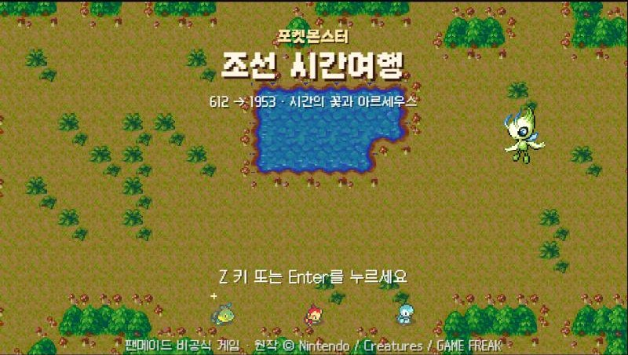
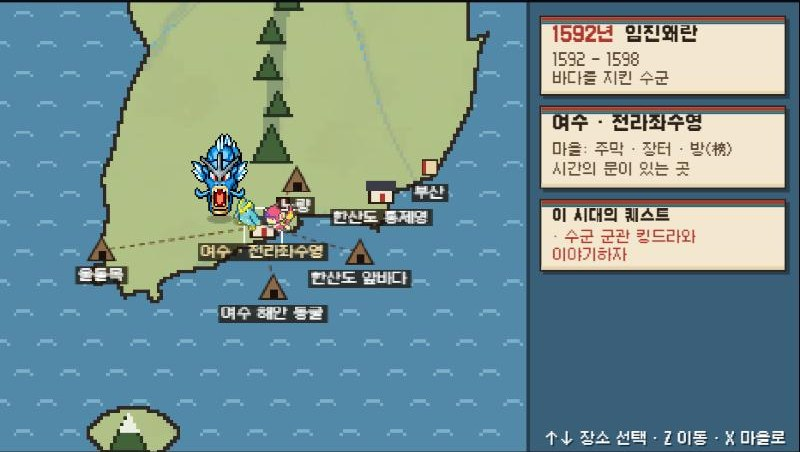
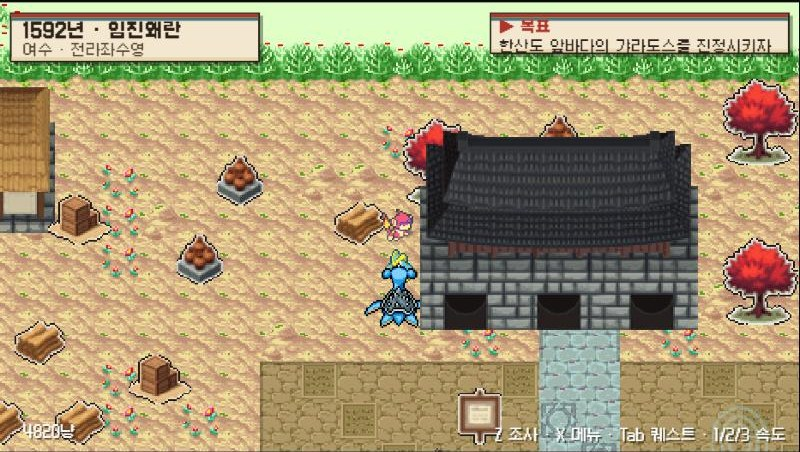
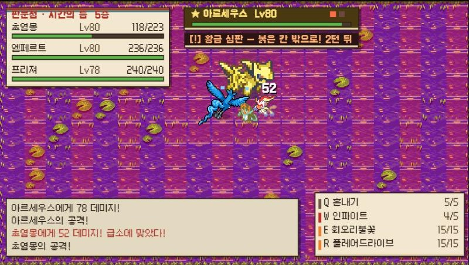
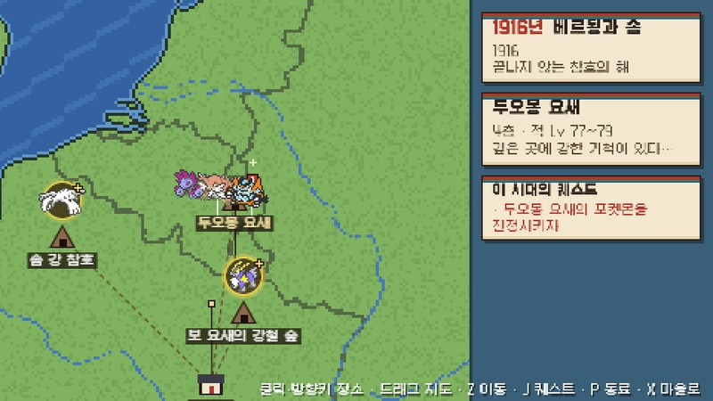
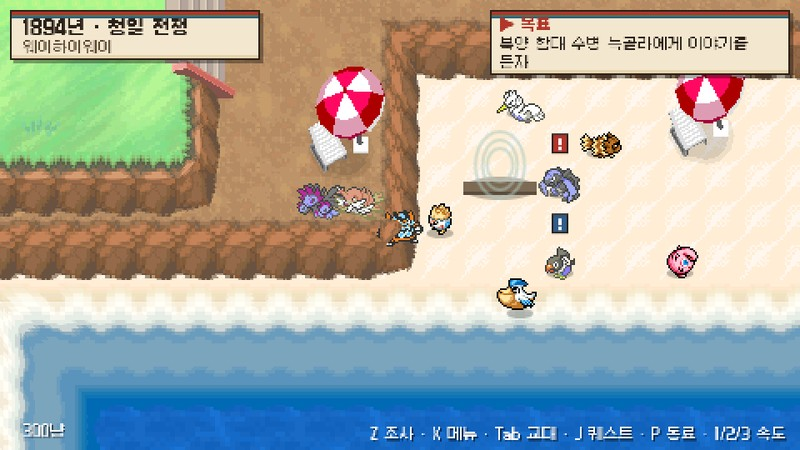
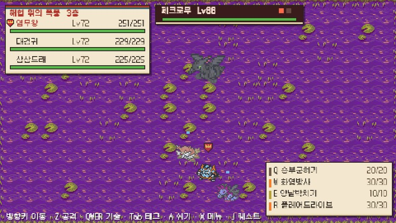

# 포켓몬 조선 시간여행

**고구려 살수대첩(612)부터 1979년 12·12까지 한국사 20개 시대, 그리고 1860년부터 1945년까지 세계사 21개 시대를 여행하는 「포켓몬 불가사의 던전」풍 비공식 팬게임**

세레비와 함께 부서진 「시간의 꽃」 꽃잎 20장을 찾아 한반도의 역사 속을 여행합니다. 각 시대 사람들과 포켓몬의 소원을 들어주면 꽃잎이 다시 빛나고, 다음 시대로 가는 시간의 문이 열립니다. 이야기는 실제 역사의 흐름을 따라갑니다.

광복(1945) 뒤에는 한국 이야기와 따로, 청일 · 러일 전쟁과 두 차례의 세계 대전을 지나는 **[세계 모드](#세계-모드)**가 열립니다. 세계 시대의 마을은 「포켓몬스터 블랙」의 실제 마을이고, 5세대 포켓몬 156종이 나옵니다.

> 이 게임은 닌텐도·크리처스·게임프리크·스파이크 춘소프트와 관계없는 **비상업 팬게임**입니다. 아래 [저작권 고지](#저작권-고지)를 꼭 읽어 주세요.

## 바로 플레이

| 주소 | 비고 |
|---|---|
| **https://joseon-poke-timetravel.netlify.app** | Netlify |
| **https://jbh99.github.io/joseon-poke-timetravel/** | GitHub Pages (이 저장소에서 자동 배포) |

- 설치 없이 브라우저에서 바로 실행됩니다. PC의 크롬·엣지·파이어폭스를 권장하고, 스마트폰은 화면 버튼으로 조작합니다.
- 처음 접속하면 게임 가이드가 열립니다. 게임 중에도 **H** 키나 오른쪽 위 **가이드** 버튼으로 다시 볼 수 있습니다.
- 안드로이드 폰에는 **[앱(APK)을 받아](#내려받아-설치하기)** 설치할 수도 있습니다.

| 타이틀 | 세계 지도 |
|---|---|
|  |  |
| **마을** | **황금빛 아르세우스 (2페이즈)** |
|  |  |

## 안드로이드 앱

웹 게임 전체를 앱 안에 담은 안드로이드 버전입니다. **인터넷 없이 플레이**되고, 멀티플레이(함께 하기)만 인터넷이 필요합니다.

### 내려받아 설치하기

**[📱 APK 내려받기 (joseon-poke.apk)](https://github.com/jbh99/joseon-poke-timetravel/releases/latest/download/joseon-poke.apk)** · [릴리스 페이지](https://github.com/jbh99/joseon-poke-timetravel/releases/latest) (같은 파일을 zip으로 묶은 것도 있습니다)

플레이 스토어 밖에서 받는 앱이라 설치할 때 안드로이드가 경고를 몇 번 띄웁니다. 순서대로 누르면 설치됩니다.

1. 휴대폰 **크롬**에서 위 링크를 누릅니다. 기기에 해로울 수 있는 파일이라는 경고가 나오면 **다운로드**를 누릅니다.
2. 다운로드가 끝나면 **열기**를 누릅니다 (또는 내 파일 → 다운로드에서 `joseon-poke.apk`를 누릅니다).
3. 이 출처의 알 수 없는 앱은 설치할 수 없다는 창이 뜨면 **설정** → **이 출처 허용**을 켜고 뒤로 돌아옵니다.
4. **설치**를 누릅니다.
5. Play 프로텍트 창이 뜨면 **앱 검사**를 하거나 **검사 없이 설치**를 누릅니다. '차단됨'으로 나오면 **자세히** → **무시하고 설치**를 누릅니다.

- 삼성 갤럭시에서 **자동 차단**이 켜져 있으면 설치 자체가 막힙니다. 설정 → 보안 및 개인정보 보호 → 자동 차단을 잠시 끄고 설치한 뒤 다시 켜면 됩니다.
- 새 버전이 나오면 같은 방법으로 설치합니다. 기록은 그대로 두고 업데이트됩니다.
- 안드로이드 7.0 이상에서 설치됩니다.

### 앱 화면과 조작

- **화면**: 가로 화면 고정 · 전체 화면. 가운데에 게임, 왼쪽에 이동 패드, 오른쪽에 버튼이 놓여 게임 화면을 가리지 않습니다. 16:9나 태블릿처럼 네모난 화면에서는 게임 화면이 조금 좁아져 버튼 자리를 비웁니다(1.14).
- **이동 패드**(왼쪽 아래 원): 손가락을 대고 밀면 그쪽으로 움직입니다. 화살표가 8개 그려져 있고, 던전에서는 대각선 화살표까지 모두 켜져 8방향으로 움직입니다(마을과 지도는 4방향이라 대각선 화살표가 흐립니다).
- **버튼**: 키보드와 같은 글자가 적혀 있어 화면 아래 안내를 그대로 따르면 됩니다.

  | 버튼 | 기능 |
  |---|---|
  | **Z** 확인 · **X** 취소 | 조사·대화·공격·결정 / 취소 (마을과 던전에서는 게임 메뉴) |
  | **Q W E R** (십자 배치) | 던전에서 기술 1~4. 위 Q · 왼쪽 W · 오른쪽 E · 아래 R의 둥근 버튼마다 그 기술의 **이름 · 범위 · 남은 PP**가 적혀 있습니다 (던전 밖에서는 숨겨집니다) |
  | **Tab** 태그 | 조종할 포켓몬 교대. 한 턴 쉬기는 **메뉴** 안에 있습니다 (키보드는 A) |
  | 오른쪽 위 **메뉴** | 게임 메뉴 · 퀘스트 · 동료 · 던전 지도 · 한 턴 쉬기와 소리 · 속도(1→2→3배) · 멀티 · 구글 로그인 · English · 가이드를 한 화면에 엽니다 |

- 세계 지도의 장소, 대화 선택지, 메뉴는 화면을 직접 눌러 고를 수 있고, 긴 목록은 손가락으로 끌어 넘깁니다. 게임은 화면 전체를 쓰고, 오른쪽 버튼들은 그 위에 겹쳐 있습니다.
- 휴대폰의 **뒤로 가기**는 X와 같습니다. 가이드나 멀티 창은 닫고, 타이틀 화면에서 누르면 앱을 끝냅니다.
- 블루투스·USB 게임패드: A 확인 · B 메뉴 · X/Y/LB/RB 기술 1~4 · LT 방향만 · RT 쉬기 · Start 메뉴 · Select 퀘스트 · 십자키나 왼쪽 스틱 이동.
- 앱을 내려 두면 음악이 멈춥니다. 기록은 휴대폰 안에 저장되고, **구글 로그인**을 하면 내 구글 드라이브의 앱 전용 숨김 폴더를 거쳐 PC 웹 버전과 같은 세이브로 이어집니다(난이도마다 따로).
- 멀티플레이는 웹 버전과 서로 연결됩니다. 앱에서 방을 열면 초대 링크는 GitHub Pages 주소로 만들어집니다.

### 앱 빌드

`mobile/`이 [Capacitor](https://capacitorjs.com) 안드로이드 프로젝트이고, `tools/build_mobile.ps1`이 `web/`을 `mobile/www`로 복사한 뒤 디버그 APK를 만듭니다. JDK 21과 Android SDK가 필요합니다 (스크립트 안의 경로를 자기 PC에 맞게 바꾸세요).

`-Release`는 배포용 APK를 만듭니다. 디버그 빌드와 같은 키(`~/.android/debug.keystore`)로 서명하는데, 구글 로그인이 그 인증서의 SHA-1에 등록되어 있고 이미 설치한 폰에서 그대로 업데이트되기 때문입니다. 이 키를 잃어버리면 기존 설치본을 업데이트할 수 없으니 따로 백업해 두세요.

```powershell
cd mobile; npm install; cd ..
.\tools\build_mobile.ps1          # mobile\android\app\build\outputs\apk\debug\app-debug.apk
.\tools\build_mobile.ps1 -Release # 배포용: mobile\release\joseon-poke.apk, joseon-poke-apk.zip
adb install -r mobile\android\app\build\outputs\apk\debug\app-debug.apk
```

## 조작법

| 키 | 기능 |
|---|---|
| **방향키** | 이동 (던전은 8방향, 대각선은 두 키를 동시에) |
| **Z / Enter / Space** | 조사 · 대화 · 기본 공격 · 결정 |
| **X / Esc / C** | 메뉴 · 취소 (예/아니오 질문에서는 '아니오') |
| **Q W E R** | 던전에서 기술 1~4 사용 |
| **Tab** | **태그**: 던전에서는 조종할 포켓몬을 다음 동료로 교대 (턴 소모 없음), 마을에서는 다음 동료가 앞장서도록 팀 순서를 돌림 |
| **A** (누르고 있기) | 쉬기 · 턴 넘기기 |
| **Shift + 방향키** | 제자리에서 방향만 바꾸기 |
| **J** | 퀘스트 목록 열기 · 한 번 더 누르면 닫기 |
| **P** | 동료 명부 열기·닫기 (마을과 세계 지도에서, 던전 밖에서만) |
| **M** | 던전 미니맵 켜고 끄기 |
| **1 / 2 / 3** | 게임 속도 1배 · 2배 · 3배 |
| **H** | 게임 가이드 열기·닫기 |
| **마우스** | 세계 지도에서 가고 싶은 장소 클릭 · 대화와 선택지, 메뉴 클릭 |

- **X 메뉴 → 설정**에서 소리 켜기/끄기, 화면 아래 조작키 안내 보이기/숨기기, 게임 속도를 바꿀 수 있습니다. 오른쪽 위 **소리** 버튼으로도 바로 끌 수 있습니다.
- **X 메뉴 → 게임 종료**: 마을에서는 기록을 남기고 타이틀로 돌아갑니다. 던전 안에서 끝내면 던전 진행은 저장되지 않고, 마지막으로 마을에 들렀을 때부터 이어집니다.
- 오른쪽 위 **English / 한국어** 버튼을 누르면 게임을 다시 시작하지 않고 대사, 이름, 메뉴가 그 자리에서 바뀝니다.

## 게임 진행

1. **새로운 여행**에서 난이도(쉬움 · 보통 · 어려움, 엔딩 후 챌린지)를 정하고 주인공과 파트너를 고릅니다 (모부기·불꽃숭이·팽도리). 시간을 건너온 탓에 둘 다 **이로치**입니다.
2. **마을**: 머리 위에 **!** 표시가 있는 포켓몬이 메인 퀘스트 상대입니다.
   - **주막**: 회복 · 기록 · 동료 명부
   - **장터**: 도구 사고팔기 (사기 목록 맨 위에서 10개씩 사기, 팔기 목록에서 1개씩 · 10개씩 · 전부, 가진 도구 모두 팔기)
   - **방(榜)**: 의뢰 게시판
   - 많은 시대에 큰 중심 마을과 함께 **두 번째 마을**이 있습니다.
3. **세계 지도**: 마을 출구로 나가면 열립니다. 장소를 클릭(터치)하거나, 방향키를 누르면 그 방향에서 가장 가까운 장소로 옮겨 갑니다. 마우스로 끌거나(드래그) 휠을 굴려 지도를 둘러봅니다. 빨간 표시는 메인 퀘스트, 파란 표시는 맡은 의뢰, 금색 테두리 안의 포켓몬은 그곳에 있는 전설의 포켓몬입니다. 1.12부터 서로 가까이 붙은 장소는 표시와 이름이 겹치지 않게 벌려 놓고, 실제 위치는 작은 점과 선으로 이어 줍니다.
4. **던전**: 층마다 지형이 무작위로 만들어지는 턴제 던전입니다. 계단을 찾아 내려가고, 마지막 층의 보스를 쓰러뜨립니다.
5. 메인 퀘스트를 끝내면 광장의 **시간의 문**이 열리고 다음 시대로 넘어갑니다.
6. 마을에 돌아올 때마다 **자동 저장**됩니다. 저장은 브라우저(localStorage)에 남으니 같은 브라우저에서 **이어하기**를 고르세요.
   - 기록은 **난이도마다 따로** 남습니다. 엔딩을 본 뒤 다른 난이도로 **새로운 여행**을 시작해도 다 깬 기록은 그대로 남고, 같은 난이도로 새로 시작하면 그 난이도의 지금 여행은 타이틀의 **지난 여행**으로 보관되어(1.20, 난이도마다 5개까지) 언제든 골라서 다시 이어 할 수 있습니다. 기록이 여러 개면 이어하기에서 어느 기록으로 이어 할지 고릅니다(엔딩까지 본 기록에는 ★).

메인 스토리만 하면 1배속으로 약 4시간 안팎, 3배속으로 2~3시간쯤 걸립니다 (의뢰는 제외, 플레이 실력에 따라 차이가 큽니다).

## 20개 시대

| 연도 | 시대 | 마을 | 메인 던전 | 주요 보스 |
|---|---|---|---|---|
| 612 | 살수대첩 | 평양성 / 살수 나루 | 요동 들판, 살수(해전) | 성원숭, 메깅 |
| 660 | 황산벌 전투 | 사비성 / 웅진성 | 황산벌, 부소산성, 평양성(668, 고구려 최후의 전투) | 켄타로스, 나인테일, 보스로라 |
| 676 | 나당 전쟁 | 서라벌 / 감포 바닷가 | 매소성, 기벌포(해전) | **썬더**, 킹크랩 · 루기아(선택) |
| 1019 | 귀주대첩 | 개경 / 서경 | 흥화진 냇물(해전), 귀주 벌판 | 대짱이, **앤테이** |
| 1232 | 대몽 항쟁 | 강도(강화) / 충주성 | 처인성, 황룡사 | 프테라, **파이어** |
| 1388 | 위화도 회군 | 개경 · 고려 말 / 남원 운봉 | 진포(해전), 황산, 위화도 | 대포무노, 다탱구, **프리져** |
| 1392 | 조선 건국 | 한양 / 개경 · 옛 도읍 | 인왕산 숲길 | **라이코** |
| 1443 | 훈민정음 | 한양 · 집현전 | 집현전 서고 | **칠색조** |
| 1592 | 임진왜란 | 여수 · 전라좌수영 / 한산도 통제영 | 한산도 · 울돌목 · 노량 (모두 해전) | 갸라도스 · 아그놈(전라 우수영, 선택) |
| 1636 | 병자호란 | 남한산성 / 강화도 | 눈보라 산길 | 맘모꾸리 · 스이쿤(얼음 신전, 선택) |
| 1794 | 수원 화성 | 수원 화성 | 숙지산 채석장 | 거대코뿌리 · 유크시(규장각, 선택) |
| 1866 | 병인양요 · 신미양요 | 강화도 | 정족산성, 광성보 | **가디안**, 자포코일 · 크레세리아(선택) |
| 1887 | 대한제국 | 한성 / 제물포 항구 | 건청궁 발전소 | 에레키블, **메타그로스** · 지라치(선택) |
| 1905 | 을사늑약 | 한성(1905) | 경운궁 중명전 · 헤이그 특사(이야기) | **뮤츠**(2페이즈) |
| 1919 | 3·1 운동 | 경성 / 아우내 장터 | 경성 뒷골목 | **디아루가** · 엠라이트(탑골 공원, 선택) |
| 1920 | 독립군 | 독립군 기지(만주) / 용정 | 청산리 골짜기 | 핫삼 · 히드런(선택) |
| 1940 | 민족 말살 통치 | 경성(1940) / 충칭 · 임시정부 | 반전세계 | **기라티나** |
| 1945 | 광복 | 서울 | 시간의 틈 · 얄타·포츠담 회담과 분단(이야기) · 진영 선택 | **펄기아** |
| 1950 | 한국 전쟁 | 진영에 따라 다름 | 서울 시가전, 낙동강, 해전, 장진호, 판문점, 하늘기둥(서울 시가전 뒤) | 그란돈/가이오가, **한카리아스**, **보만다**, 레쿠쟈 · 테오키스 |
| 1979 | 10·26과 12·12 | 서울(1979) | 12월 12일 밤의 서울(마을 전투), 청계천 판자촌, **천관산(마지막 퀘스트)**, 보스 탑(아르세우스 뒤) | **다크라이**, 강화된 **펄기아 · 디아루가**, **아르세우스(팀 레벨)** |

## 세계 모드

**1860년 베이징 조약부터 1945년 제2차 세계 대전의 끝까지, 세계사 21개 시대.** 한국 이야기와 따로 이어지는 두 번째 여행입니다.

- **들어가기**: 1945년 이후 한국 시대의 시간의 문에서 **「세계로」**를 고릅니다. 시대 퀘스트를 끝내지 않아도 됩니다(1.26). 처음 들어가면 1860년부터 시작합니다.
- **한국과 오가기**: 세계 시대의 시간의 문에서는 퀘스트를 끝내지 않아도 언제든 **「한국으로 돌아가기」**를 고를 수 있습니다. 한국 이야기와 세계 이야기는 각자 멈춘 곳을 기억해서, 다시 넘어가면 떠났던 시대부터 이어집니다. 새 여행을 시작하면 세계 모드도 1860년부터 다시 시작합니다(1.11에서는 게임을 끄지 않고 새 여행을 시작하면 앞 여행의 위치를 물려받아, 세계 모드가 1915년부터 열리거나 새 챌린지가 전멸해도 끝나지 않았습니다).
- **난이도**: 처음부터 적이 내 팀에서 가장 높은 레벨보다 5~7 레벨 높고, 초반 배려가 없습니다. 어려움(+25%)과 챌린지(전멸하면 여행이 끝남) 규칙도 그대로입니다.
- **마을**: 그 시대의 도시를 「포켓몬스터 블랙」의 실제 마을 11곳 가운데 하나로 그렸습니다. 롬의 지도 · 건물 · 이동 데이터를 그대로 읽어서 걸을 수 있는 곳이 원작과 같습니다. 1.12부터 마을 밖(다른 도로의 구역, 걸어서 닿을 수 없는 빈터)은 어둡게 그려서 갈 수 있는 곳이 한눈에 보입니다. 1.13부터 마을의 포켓몬은 서로 **두 칸 이상** 떨어져 서고, 서 있거나 돌아다니는 자리 옆으로 길이 **두 칸 폭**은 남도록 비켜 섭니다(1.12까지는 자리가 모자라면 시간의 문 둘레에 몰려 서서, 좁은 바닷가 마을에서는 길을 막기도 했습니다). 어느 마을에서든 사람이 길을 끊거나 두 칸 길을 한 칸으로 좁히지 않습니다.
- **세계 지도**: Natural Earth 지도 데이터로 그린 동아시아 · 유럽 · 태평양 지도입니다.
- **포켓몬**: 5세대 포켓몬 156종이 블랙의 그림 · 아이콘 · 울음소리 · 능력치 · 기술로 세계 시대의 던전에 나옵니다. 배경 음악도 블랙의 음악입니다.

| 세계 지도 (1916 베르됭과 솜) | 웨이하이웨이 (물결마을) | 둥지의 전설 (제크로무) |
|---|---|---|
|  |  |  |

### 개항과 제국주의 (1860–1905)

| 연도 | 사건 | 마을 (블랙의 마을) | 던전 | 보스 |
|---|---|---|---|---|
| 1860 | 베이징 조약 | 베이징 (쌍용시티) | 불타는 원명원, 우수리강 국경 | **쉐이미**, **비리디온 (2페이즈)** |
| 1894 | 청일 전쟁 | 웨이하이웨이 (물결마을) | 풍도 앞바다(해전), 황해 해전(해전) | **마나피**, 두빅굴 |
| 1904 | 러일 전쟁 | 뤼순 (물풍경시티) | 제물포 해전(해전), 203고지, 쓰시마 해전(해전) | 대검귀, **테라키온 (2페이즈)**, **볼트로스 (영물폼)** |

### 제1차 세계 대전 (1914–1919)

| 연도 | 사건 | 마을 (블랙의 마을) | 던전 | 보스 |
|---|---|---|---|---|
| 1914 | 사라예보 사건 | 사라예보 (칠보시티) | 라틴 다리 골목, 발칸 산길 | 펜드라, **쉐이미** |
| 1914 | 마른 전투 | 파리 (뇌문시티) | 마른 강 전선, 무인 지대 | **케르디오**, **쉐이미** |
| 1915 | 갈리폴리 전투 | 갈리폴리 (마름꽃마을) | 다르다넬스 해협(해전), 안작 만 절벽 | **마나피**, 기가이어스 |
| 1916 | 베르됭과 솜 | 베르됭 (설화시티) | 두오몽 요새, 솜 강 참호 | **코바르온 (2페이즈)**, **게노세크트** |
| 1916 | 유틀란트 해전 | 스캐파 플로 (물풍경시티) | 북해의 안개(해전), 유틀란트 해전(해전) | **토네로스 (영물폼)**, 샹델라 |
| 1918 | 휴전 | 콩피에뉴 (넝쿨마을) | 콩피에뉴 숲, 마지막 날의 전선 · 아르곤 숲 깊은 곳(선택) | **비리디온 (2페이즈)**, **비크티니** · **뮤** |
| 1919 | 파리 강화 회의 | 파리 · 베르사유 (성신시티) | 거울의 방, 센 강 다리 밑 | **메로엣타**, **쉐이미** |

### 제2차 세계 대전 (1939–1945)

| 연도 | 사건 | 마을 (블랙의 마을) | 던전 | 보스 |
|---|---|---|---|---|
| 1939 | 제2차 세계 대전의 시작 | 단치히 · 그단스크 (칠보시티) | 베스테르플라테, 단치히 우체국 | 염무왕, **코바르온 (2페이즈)** |
| 1940 | 됭케르크 철수 | 됭케르크 (물풍경시티) | 됭케르크 방파제, 영국 해협(해전) · 이제르 강 물길(선택) | 타격귀, **케르디오 (2페이즈)** · **피오네** |
| 1940 | 런던 대공습 | 런던 (궐수시티) | 비긴 힐 비행장, 대공습의 밤(마을 전투) | **토네로스 (영물폼)**, **레시라무 (두 번 일어섬)** |
| 1941 | 모스크바 전투 | 모스크바 (쌍용시티) | 라스푸티차의 진흙길, 모스크바 근교 설원 | **랜드로스 (영물폼)**, 불비달마 (2페이즈) |
| 1942 | 진주만과 미드웨이 | 호놀룰루 (물결마을) | 진주만(해전), 미드웨이 해전(해전) | **마나피**, 불카모스 (2페이즈) |
| 1942 | 레닌그라드 포위전 | 레닌그라드 (칠보시티) | 라도가 호수 얼음길, 얼어붙은 연주회장 | 액스라이즈, **메로엣타 (2페이즈)** |
| 1942 | 엘알라메인 전투 | 알렉산드리아 (물결마을) | 「악마의 정원」 지뢰밭, 모래 언덕의 V 유적 | **랜드로스 (영물폼)**, **비크티니 (2페이즈)** |
| 1943 | 스탈린그라드와 쿠르스크 | 스탈린그라드 (설화시티) | 트랙터 공장, 프로호롭카 전차 평원 | **테라키온 (2페이즈)**, **게노세크트 (2페이즈)** |
| 1944 | 노르망디 상륙 작전 | 노르망디 · 바이외 (마름꽃마을) | 해협 위의 폭풍, 오마하 해변 | **제크로무 (두 번 일어섬)**, 대검귀 |
| 1944 | 레이테 만 해전 | 타클로반 · 레이테 (물결마을) | 수리가오 해협(해전), 사마르 앞바다(해전) | **볼트로스 (영물폼)**, **마나피** |
| 1945 | 제2차 세계 대전의 끝 | 베를린 (보배마을) | 얼어붙은 폐허, **얼어붙은 도시(마을 전투, 최종 퀘스트)** | 삼삼드래, **큐레무 (3페이즈)** |

(선택)은 메인 퀘스트와 상관없이 들어가는 전설의 둥지입니다(1.20부터 뮤 · 피오네 두 곳). 굵은 글씨는 전설 · 환상의 포켓몬이고, 나머지는 5세대의 강자들과 600족 삼삼드래입니다. (2페이즈) · (영물폼) · (3페이즈)는 모습을 바꿔 다시 일어서는 보스이고, 같은 포켓몬이 다른 시대에 한 번 더 나올 때는 한 가지 모습으로 싸웁니다(토네로스 · 볼트로스 · 랜드로스 · 코바르온 · 테라키온 · 비리디온은 두 번 모두 두 모습으로). 세계 모드의 던전은 1.19부터 모두 **3층**이 끝이고, 그 3층에서 보스가 기다립니다.

### 세계 모드의 전설과 최종 보스
- **퀘스트 보스 (1.20)**: 세계 모드의 퀘스트 보스는 **5세대(블랙)의 전설 · 준전설 · 환상의 포켓몬**입니다. 레시라무 · 제크로무 · 큐레무는 한 번, 나머지 열(비크티니 · 코바르온 · 테라키온 · 비리디온 · 케르디오 · 토네로스 · 볼트로스 · 랜드로스 · 메로엣타 · 게노세크트)은 두 시대에 한 번씩 나오고, 처음 이긴 곳에서 동료가 될 수 있습니다(이미 동료면 다시 동료가 되지 않음). 5세대 600족 **삼삼드래**는 1945년 얼어붙은 폐허에서 한 번만 나오고(1.25), 다른 강한 자리는 샹델라 · 타격귀 · 기가이어스 · 두빅굴 · 염무왕 · 대검귀(두 번) · 펜드라 · 액스라이즈와 2페이즈의 불비달마(달마폼) · 불카모스, 남는 자리는 4세대 환상의 포켓몬 **쉐이미 · 마나피**(4번씩)가 맡습니다. 1.19까지 세계 모드에 나오던 전설 중 칠색조 · 라이코 · 앤테이는 한국 시대의 퀘스트(1443 · 1392 · 1019)로, 뮤 · 피오네는 둥지로 옮겼고, 나머지는 한국 시대에서 만납니다.
- **5세대 전설의 2페이즈**: 전용기를 쓰면 몇 턴 동안 맵 곳곳의 붉은 칸에 번개 · 불꽃 · 바위 · 돌풍이 떨어지거나, 성스러운칼 · 신비의칼처럼 땅이 줄을 따라 갈라집니다. **토네로스 · 볼트로스 · 랜드로스**는 2페이즈에서 **영물폼**으로 바뀌며 **모든 능력치와 HP가 20% 오릅니다**(1.20). 블랙 롬에는 케르디오의 각오의 모습과 영물폼 그림이 없어서(블랙2 · 화이트2에서 처음 나옴), 2페이즈는 같은 모습에 빛과 이름으로 나타냅니다.
- **레시라무 · 제크로무 (1.19)**: 천관산 펄기아 수치(이야기 때보다 체력 · 공격 30% 높고 모든 능력치 +20%, 내 팀 레벨을 따름)에 체력 · 모든 능력치 · 공격 상한 · 궁극기를 **10% 더한** 스펙으로, 3페이즈로 싸웁니다. 1페이즈는 평범한 기술만, 2페이즈는 평범한 기술과 궁극기, 3페이즈는 궁극기만 계속 씁니다. 이기고 동료가 되면 궁극기 기술을 가지고 옵니다.
  - **레시라무 · 크로스플레임**: **5초 동안** 위에서 불이 내 위치와 근처 동료를 따라 떨어집니다. 붉게 표시된 칸에 떨어지니 멈추지 말고 움직이세요. 턴과 상관없이 실제 시간으로 흐르고, 대화나 메뉴가 열리면 멈춥니다.
  - **레시라무 · 푸른불꽃**: 붉은 칸에 떨어진 자리에 **파란 불꽃이 5턴 동안 남아**, 그 위에서 턴을 마치면 피해를 받고 화상을 입을 수 있습니다.
  - **제크로무 · 뇌격**: 붉은 칸에 번개가 떨어집니다. 표시를 보고 피할 수 있습니다.
  - **제크로무 · 크로스썬더**: **표시 없이** 5턴 동안 번개가 무작위로 떨어집니다. 피할 수 없으니 HP를 넉넉히 채워 두세요.
- **최종 보스 큐레무**: 1945년의 마지막 퀘스트입니다. 베를린이 그대로 싸움터가 되어 1페이즈 큐레무 → 2페이즈 블랙큐레무 → 3페이즈 화이트큐레무로 싸웁니다. 1.19부터 레시라무 · 제크로무와 같은 체력 · 공격에 모든 능력치 +44%(둘은 +32%)입니다. 블랙큐레무는 레시라무와 제크로무의 궁극기 넷을 번갈아 쓰고, 화이트큐레무는 궁극기만 **두 개씩 동시에** 씁니다. 이기면 항복과 해방의 이야기로 세계 모드가 끝납니다.
- **엔딩 (1.13부터)**: 한국 이야기의 **아르세우스(1979)**와 세계 모드의 **큐레무(1945)**를 **모두** 쓰러뜨려야 엔딩이 열립니다. 나중에 끝낸 쪽의 시간의 문에서 「엔딩으로」를 고르고, 한쪽만 끝냈다면 세레비가 남은 쪽으로 안내합니다. 엔딩의 크레디트와 명예의 전당에도 세계 모드가 함께 나옵니다. 아르세우스만으로는 엔딩을 볼 수 없습니다. 1.15부터는 1.12까지 아르세우스만으로 엔딩을 연 예전 기록도 큐레무를 쓰러뜨려야 엔딩이 열리고, ★와 챌린지 달성도 그때부터입니다(1.13 · 1.14에서는 그런 기록을 엔딩을 본 것으로 쳤습니다).
- **동료**: 전설도, 던전의 일반 보스도 이기면 동료로 맞이할 수 있습니다 (일반 보스는 1.12부터. 챌린지에서는 전설만 동료가 되지 않음).

## 게임 요소

### 도감 (1.11)
- **도감**: X 메뉴 → 도감. 전국(1~649) · 신오(4세대, 펄) · 하나(5세대, 블랙) 도감 순서로 보고, 포켓몬마다 펄 도감과 블랙 도감 페이지(그림 · 분류 · 설명)를 바꿔 볼 수 있습니다. 만난 포켓몬은 「발견」, 동료가 된 포켓몬은 「포획」으로 기록되고, 「전체 보기」로 모든 페이지를 열 수 있어요. 그림을 누르면 울음소리가 납니다. 영어 모드에서는 분류와 설명이 영어로 나옵니다(1.14, 롬의 한국어 설명을 옮긴 것).
- 배경 음악은 포켓몬스터 블랙의 음악으로 바뀌었고, 휴대폰에서는 십자 패드가 게임 화면 안으로 들어가 화면이 커졌고, 메뉴 버튼은 오른쪽 버튼 줄 맨 위로 옮겼습니다.

### 전설의 포켓몬과 보스
- **썬더(676) · 앤테이(1019) · 파이어(1232) · 프리져(1388) · 라이코(1392) · 칠색조(1443)**: 같은 시대 보스 중 가장 강합니다(앤테이 · 라이코 · 칠색조는 1.20부터). 체력이 보통 보스의 약 10배이고, 예고 공격을 모으는 동안에도 계속 공격합니다. 어렵다면 레벨을 올려 다시 도전하세요. 전설의 레벨은 일정 이상 오르지 않습니다.
- **놓친 전설**: 전설의 포켓몬을 그 시대에 동료로 맞지 못하면(만나지 못했거나 보내 주었으면), 다음 시대의 다른 던전에 다시 나타납니다. 그 던전의 마지막 층에서 그 던전의 적과 같은 레벨로 기다리고, 또 놓치면 그다음 시대로 옮겨 갑니다. 그 층에서 기다리는 구출 의뢰의 포켓몬도 그대로 나타납니다(1.16).
- **예고 공격**: 보스가 바닥을 붉게 표시하면 몇 턴 뒤 그 칸에 큰 공격이 떨어집니다. 붉은 칸 밖으로 피하면 보스에게 **빈틈**이 생겨 받는 피해가 1.5배가 됩니다.
- **600족 보스**: 메타그로스(1887), 한카리아스·보만다·마기라스(1950)는 전설의 포켓몬보다 15%쯤 약한 강적입니다 (레벨 +2, 체력·공격·예고 공격이 전설의 85%). 전설이 아니므로 세계 지도에 금빛 전설 표시가 붙지 않습니다(백마고지의 마기라스도 1.8부터).
- **던전 깊이**: 1.8부터 모든 던전은 **4층까지**이고, 보스는 마지막 층(4층)에서 기다립니다 (예전 5~6층 던전: 경성 뒷골목, 청산리 골짜기, 반전세계, 시간의 틈, 경운궁 중명전, 판문점). 천관산과 보스 탑은 단계마다 한 층이라 그대로입니다.
- **일반 보스**: 1200년부터 체력이 30% 늘어나고, 우리 팀이 성장하면 보스 레벨도 함께 오릅니다.

### 2페이즈 · 3페이즈
- **아르세우스**(최종 보스, 3페이즈): 1979년 12·12 뒤 **마지막 퀘스트**인 「천관산」 꼭대기, 시작의 방에서 기다립니다. 레벨은 고정이 아니라 **내 팀의 레벨에 맞춰** 정해집니다(최소 70, 최대 180). 쓰러뜨리면 **황금빛 이로치**로 다시 일어납니다(2페이즈: 체력은 처음의 2/3, 공격과 예고 패턴이 훨씬 거셈). 2페이즈부터 **심판의 뭉치**가 하늘에서 필드 곳곳에 원 모양으로 쏟아집니다. 또 쓰러뜨리면 무지갯빛으로 일어나는 **3페이즈**(체력 절반, 공격 +10% · 방어 +20%)에서는 매 턴 쏟아지는 심판과 **동시에** **파괴광선**을 360도로 한 바퀴 돌리며 세 번 휘두릅니다 (다음에 지나갈 줄기와 심판이 떨어질 칸이 함께 붉게 빛남). 1.9부터 파괴광선이 도는 동안에도 심판이 멈추지 않고, 파괴광선 피해가 **40%** 커졌습니다.
- **다크라이**(1979 12·12 마을 전투, 1979년 전에는 나오지 않음, 3페이즈, 1.8부터 혼자 싸우며 모든 능력치 +25%): **다크홀**(발밑에 열린 검은 구멍에 빠지면 잠듦) → 악몽의 모습(다크홀 · **섀도다이브**) → 칠흑의 모습(공격 +10% · 방어 +20%, **악의파동**까지).
- **레쿠쟈**: 쓰러뜨리면 **메가레쿠쟈**로 다시 일어나 유성을 불러냅니다.
- **테오키스**: 노말폼으로 싸우다 체력이 반 아래로 내려가면 **어택폼**으로, 쓰러뜨리면 **스피드폼**으로 다시 일어납니다 (공격이 잘 맞지 않음).
- **디아루가(1919) · 기라티나(1940) · 펄기아(1945)**: 쓰러뜨리면 **오리진폼**으로 변해 2페이즈를 시작합니다. 1.7에서 이 셋과 **뮤츠**는 **체력 +30% · 공격 +15%**로 강해졌습니다(아르세우스는 1.5의 +10% 그대로).
- **전설의 전용기**: 1페이즈에 한 번, 2페이즈에 두세 번 씁니다. 체력이 그 고비에 닿으면 전용기를 쓰기 전까지는 더 깎이지 않습니다.
  - **디아루가 · 시간의 포효**: 한 턴 기를 모은 뒤 시간을 되감아 **10초 전의 체력**으로 돌아가고, 우리 편 모두의 HP를 최대치의 **33%** 깎으며(1.16까지 20%, 마지막 퀘스트의 디아루가는 1.26부터 25%), 그 피해만큼 체력을 더 회복합니다(1.17). 그다음 턴은 반동으로 쉽니다(빈틈). 1.9부터 처음 모습과 오리진폼 **모두 두 배로 자주** 씁니다 (1919년: 처음 모습 2번 + 오리진폼 4~6번, 천관산: 4번 + 6~8번, 보스 탑: 1919년과 같음).
  - **펄기아 · 공간절단**: 공간이 찢어지며 싸움터가 바깥부터 한 겹씩 **좁아지고**(두 번까지), 바닥 곳곳의 **더 길고 많은 틈**에서 공격이 솟아오릅니다(1.7에서 피해도 0.32 → 0.42). 펄기아는 기술로 **하이드로펌프**도 씁니다.
  - **기라티나 · 섀도다이브**: **어둠 속으로 사라졌다가** 우리 포켓몬의 **그림자 밑에서 튀어나와** 공격합니다. 악 타입에 맞서 격투 기술 **파동탄**도 씁니다. 1.7부터 첫 모습에서 **그림자 폭풍 · 대지의힘 · 용성군 · 파동탄 · 원시의힘**을 번갈아 예고하고, 섀도다이브와 **용의파동**(여덟 방향 파동) 두 전용기를 씁니다.
  - **그란돈 · 단애의 칼 / 가이오가 · 근원의 파동** (1950 서울 시가전의 보스, 1.8부터 모든 능력치 +25%): 갈라진 땅을 따라 바위 칼날이 솟거나, 여덟 방향으로 파동이 퍼집니다. 원래 예고 공격은 대지의 힘 · 하이드로펌프로 이름이 바뀌었습니다.
- **기라티나**는 고스트·드래곤 타입이라 격투 기술은 듣지 않고 물·불꽃 기술은 반감됩니다. 1388년에 동료가 되는 프리져처럼 얼음·드래곤·고스트·악 기술을 쓰는 동료를 데려가세요.

### 천관산 (마지막 퀘스트)과 보스 탑 (보스 모드)
- **천관산**: 1979년 12·12 뒤 장흥의 천관산을 오릅니다. 들어가자마자 **펄기아**, 다음 층에서 **디아루가**가 길을 막습니다. 둘 다 이야기 때보다 **체력과 공격이 30% 더 강하고**, 예고 공격과 전용기를 **1.5배쯤 자주** 씁니다. 1.8부터 천관산의 **펄기아 · 디아루가 · 아르세우스**는 **체력과 모든 능력치가 20%** 더 오릅니다(보스 탑의 능력치는 그대로). 1.7에서 펄기아 2페이즈 도중 게임이 멈추던 문제(오리진폼이 부를 졸개가 없는 던전에서 오류가 나던 것)도 고쳤습니다. 둘을 모두 쓰러뜨리면 **천계의 피리**가 나타나고, 「포켓몬스터 펄」 롬의 실제 지도로 만든 **창기둥** 꼭대기 제단에서 피리를 불면 빛의 계단이 내려옵니다. 계단을 오른 **시작의 방**(역시 펄의 지도)에서 **아르세우스**가 기다리다가, 가까이 다가가면 깨어납니다. 한 번 쓰러뜨린 펄기아·디아루가는 다시 싸우지 않고, 다음 도전은 남은 단계부터 시작합니다.
- **보스 탑**: 1979년의 마지막 퀘스트(아르세우스)를 마치면 1979년 지도(강원도)에 **보스 탑**이 생깁니다. 10층 내내 야생 포켓몬 없이 전설의 포켓몬과만 싸웁니다.
  - 1~5층: 서로의 약점을 덮어 주는 준전설이 **둘씩** 나옵니다. 썬더·프리져, 파이어·스이쿤, 엠라이트·아그놈, 라티아스·라티오스, 레지아이스·히드런 (이야기 때의 능력 그대로). 둘이 함께 나와도 예고 공격은 한 번에 하나씩 옵니다.
  - 6~9층: **뮤츠 · 디아루가 · 펄기아 · 기라티나**가 한 마리씩, 기존보다 **15% 더 강하게**.
  - 10층: **아르세우스**, 역시 15% 더 강하게.
  - 탑의 포켓몬은 **잡을 수 없습니다**. 층을 오를 때마다 HP · PP · 상태 이상이 모두 회복되고, 다음에 들어갈 때는 지난번에 깬 층 다음부터 이어서 오를 수 있습니다. 보스 레벨은 아르세우스처럼 팀 레벨을 따라갑니다.

### 해전 (물 타입만 참가)
살수, 기벌포, 흥화진, 진포, 한산도, 울돌목(명량), 노량, 인천·대동강처럼 물 위에서 벌어지는 싸움에는 **물 타입 포켓몬만** 배에 오릅니다. 1.13부터 지도에서 해전을 고르면 팀과 동료 명부의 물 타입 목록이 열리고, 배에 태울 포켓몬을 **최대 3마리 직접 고릅니다**(고른 순서대로 앞장섬). 팀의 물 타입은 미리 골라져 있고, 목록은 **팀 먼저 · 레벨 높은 순 · 가나다 순**으로 정렬할 수 있습니다. 2마리보다 적게 고르면 모자란 자리를 수군이 빌려주고, 물 타입이 하나도 없으면 바로 2마리를 빌려줍니다. 1.12까지는 팀의 물 타입과 명부에서 레벨이 가장 높은 물 타입이 저절로 탔습니다. 첫 시대에 리아코와 물짱이를 받습니다. 수군이 빌려주는 승무원은 그 레벨에 맞게 진화한 모습(예: Lv 80 장크로다일)으로 옵니다.

1.18부터 **전투 대형**을 정해 두면 고르지 않고 **바로 출격**합니다. 마을이나 세계 지도 메뉴의 **해전 대형**에서 미리 3마리를 고르거나, 출전 목록의 **이 대형으로 고정하고 출발!**을 누르면 됩니다. 그러면 지도에서 해전을 골랐을 때 **바로 출격! / 대형 바꾸기 / 그만두기**만 묻습니다. 팀이 물 타입 3마리일 때도 같습니다.

1.18부터 **해전의 적 레벨은 출전 파티를 따릅니다.** 적과 보스 모두 **출전 파티의 최고 레벨 +3**(어려움 **+5**, 쉬움 +1, 챌린지 +3)이고, 전투 중에 레벨이 올라도 출전할 때의 레벨을 기준으로 합니다. 수군이 빌려주는 승무원도 고른 포켓몬의 최고 레벨로 오고, 아무도 고르지 않았을 때(물 타입이 없을 때)는 팀의 최고 레벨을 기준으로 합니다. 1.17까지는 해전도 육지 던전처럼 뭍에 남은 팀의 최고 레벨을 따랐습니다.

### 새로 생긴 이야기와 장치
- **마을 표시**: 빨간 `!`는 메인 퀘스트, 파란 `!`는 의뢰(새 의뢰나 보고할 의뢰가 있는 방꾼, 배달할 물건을 기다리는 사람), 엽전 표지는 장사꾼, 국밥 표지는 주막 주인, 보라색 디스크 표지는 기술머신 상인입니다.
- **펄 마을**: 1887 제물포(운하시티), 1905 한성(연고시티), 1940 경성(무쇠시티), 1950 흥남(선단시티)과 서울 시가전(장막시티), 1979 서울(들판시티)은 「포켓몬스터 펄」 롬의 실제 마을 배치(이동 가능한 칸, 건물 자리, 물, 문, NPC 자리)를 읽어 본떠 만들었습니다 (`tools/pearl_maps.py`).
- **순사 그라에나 (1905~1944)**: 일제 강점기 마을(1905 한성, 1919 경성·아우내 장터, 1920 용정, 1940 경성)에서는 순사 그라에나 6마리가 **2마리씩 3짝으로 순찰**합니다. 눈에 띄면 다가와 **500냥**을 요구하고(가진 돈이 모자라면 있는 만큼), 내거나 **그 자리에서 맞서 싸울** 수 있습니다(마을이 그대로 싸움터가 되고, 그라에나는 일반 적보다 **12% 강함**). 이기면 그 짝은 마을을 떠나고, 어느 쪽이든 그 방문 동안 다시 붙잡지 않습니다. 멀리 달아나면 쫓기를 포기하고, 말을 걸어 싸움을 걸 수도 있습니다. 독립군 기지와 충칭 임시정부에는 오지 않습니다.
- **밀정 찾기 (1920)**: 전령이 알려 주는 타입과 대략의 몸무게로, 그 타입 포켓몬들을 저울에 달아 밀정을 지목합니다. 잘못 지목하면 3년, 던전에 다녀오면 1년이 흐르고, 1930년까지 못 잡으면 경찰이 기지를 덮쳐 포켓몬이 모두 쓰러지고 처음부터 다시 찾습니다.
- **헤이그 특사 (1905)·카이로·얄타·포츠담 회담 (1940·1945)·10·26 (1979)**: 퀘스트가 아니라 이야기로 나옵니다.
- **마을 전투**: 1950년 서울 시가전과 1979년 12월 12일 밤의 서울은 마을이 그대로 싸움터가 됩니다. 1.8부터 병사들은 나오지 않고 **보스 한 마리**와 싸웁니다. 12·12에서는 **다크라이** 혼자(하나회 쪽 +15%에 더해 모든 능력치 +25%), 서울 시가전에서는 진영에 따라 **그란돈 또는 가이오가**(모든 능력치 +25%)가 보스이고, 내 진영의 전설 **한 마리**가 동료로 함께 싸웁니다. 싸움터에서는 동료가 리더를 따라다니지 않고 **각자 보스에게 달려가 자유롭게** 싸웁니다(순사와의 싸움도 같음).
- **레지 3총사와 레지기가스 (1945 이후)**: 마을의 강철 거인(레지스틸)을 동료로 맞으면 레지락·레지아이스의 굴(보스는 2층)이 지도에 나타나고, 셋을 데리고 가면 선단신전(펄의 실제 신전 지도, 2층)에서 레지기가스를 만납니다.
- **라티아스 · 라티오스 (1945 이후)**: 마을에서 둘 중 하나만 골라 동료로 맞습니다.
- **하늘기둥 (1950 서울 시가전 뒤)**: 그란돈과 가이오가가 맞부딪친 뒤 지리산에 하늘기둥이 나타납니다. 2층에서 **레쿠쟈**를 만나고(3페이즈, 화룡점정), 레쿠쟈를 쓰러뜨리면 모두 회복되어 같은 자리에 **테오키스**가 바로 내려옵니다. 둘 다 동료가 될 때까지 다시 도전할 수 있습니다 (챌린지에서는 닫힘).
- **테오키스 폼체인지**: 테오키스를 얻으면 마을에 **붉은 운석**이 생깁니다. 테오키스를 파티에 넣고 운석을 조사하면 노말폼(공격형) · 어택폼(공격·특공 크게 ↑, 방어 ↓) · 디펜스폼(방어·특방 크게 ↑, 공격 ↓) · 스피드폼(회피 +1) 가운데 고를 수 있습니다. 스프라이트도 파랑구조대 롬의 폼별 그림으로 바뀝니다.
- **레지 초상화**: 파랑구조대 롬에는 레지 3총사와 레지기가스의 얼굴이 없어서, 펄 롬의 전투 그림에서 얼굴을 잘라 같은 형식(40×40, 띠 배경)으로 만들었습니다 (`tools/make_portraits.py`).
- **1950 판문점**: 「시간의 틈」의 마지막 층은 이제 **보만다**가 지키고, 아르세우스는 여행의 맨 끝(1979)으로 옮겨 갔습니다.
- **조정**: 독 피해 절반(매 턴 최대 HP의 1/32), 파이어·프리져 체력과 피해 20% 하향.

### 진영 선택과 그란돈 · 가이오가
1945년 광복 뒤 나라가 갈라질 때 **민주주의 남한**과 **공산주의 북한** 가운데 진영을 고릅니다. 진영마다 1950년의 마을, 동료, 이야기, 해전 던전이 달라집니다. 1950년 서울 시가전에서 북쪽에는 **그란돈**, 남쪽에는 **가이오가**가 서고(내 쪽 전설은 동료로 함께 싸우고, 다른 쪽 전설이 보스), 이기면 내 쪽 전설만 **주홍구슬/쪽빛구슬**과 함께 동료가 됩니다 (다른 쪽은 얻을 수 없고 전투가 끝나면 다시 만날 수 없습니다). 이긴 뒤에는 세계 지도에서 「서울 · 1950년 6월」이 사라집니다(1.11까지는 다시 들어가면 화면이 까맣게 멈췄습니다). 구슬을 던전에서 쓰면 **원시회귀**해 그 던전이 끝날 때까지 능력이 30% 오르고, 낙동강 전선에서는 그란돈이, 인천 앞바다에서는 가이오가가 능력 +20%를 받습니다.

| 진영 | 마을 | 함께하는 포켓몬 |
|---|---|---|
| 남쪽 · 대한민국 | 부산 임시 수도 / 대구 피란민 거리 | 윈디, 킹드라, 피죤투 |
| 북쪽 | 평양 / 흥남 부두 | 링곰, 무장조, 코리갑 |

### 동료
- 쓰러뜨린 야생 포켓몬은 **35%** 확률(이로치는 70%)로 동료가 되고 싶어 합니다. **보스와 전설의 포켓몬은 이기면 반드시** 동료로 맞이할 수 있습니다.
- 파티는 주인공·파트너·동료 1마리, 모두 3마리입니다. 나머지는 **동료 명부**(최대 500마리)에서 기다리며 경험치를 절반씩 받습니다.
- **동료 바꾸기**: 던전 밖(마을·세계 지도)에서 **P**를 누르거나, X 메뉴의 **동료 명부**, 주막 주인에게 말을 걸어 명부를 엽니다. 명부 위쪽의 팀에서 하나를 고르면 서로 자리를 바꾸고, 명부의 포켓몬을 고르면 리더·파트너·동료 중 원하는 자리와 교체합니다. 명부의 동료는 던전에서 불러올 수 없습니다.
- **동료 찾기**: 명부의 **찾기**로 이름 일부, 초성(ㄹㄱㅇ → 루기아), 타입(드래곤), 도감 번호(445), "이로치"를 넣어 원하는 동료만 골라 봅니다. **정렬**은 들어온 순 · 레벨 높은 순 · 도감 번호 순 · 가나다 순입니다.
- **순서 바꾸기**: X 메뉴 → **포켓몬**에서 포켓몬을 고르고 Z를 누르면 **기술 순서 바꾸기**(Q·W·E·R 자리, 던전 안에서도 가능)와 **파티 순서 바꾸기**(리더·파트너·동료 자리, 마을에서만)가 나옵니다. 하나를 Z로 고른 뒤 바꿀 자리에서 Z를 누르면 서로 바뀝니다.
- **최대 레벨 180**: 포켓몬은 본편의 100에서 멈추지 않고 Lv 180까지 오릅니다. 아르세우스도 팀 레벨을 따라 최대 Lv 180이 됩니다. 180이 넘는 적도 동료가 될 때는 **Lv 180**으로 들어오고, 1.19까지 180을 넘게 들어온 동료는 기록을 불러올 때 180으로 맞춰집니다(1.20).
- **기술 배우기**: 레벨이 올라 새 기술을 배울 때 기술이 이미 4개면, 본편 포켓몬처럼 **잊을 기술을 고르거나 배우지 않을** 수 있습니다. 마을에서 X 메뉴 → **포켓몬** → Z → **기술 배우기**를 고르면 지금 레벨까지 배우는 기술을 언제든 배웁니다. 잊었거나 건너뛴 기술도 여기서 다시 배우고, 앞으로 배울 기술과 그 레벨도 볼 수 있습니다.
- **PP 2배**: 1.9부터 내 포켓몬(파티와 동료 명부)의 기술 PP는 원작의 **2배**입니다 (예: 10만볼트 15 → 30). 야생 포켓몬과 보스는 원작 그대로이고, 예전 기록을 불러오면 남아 있던 PP도 2배가 됩니다.
- **PP 회복**: 던전을 나오면(클리어·실패·탈출 모두) 파티의 기술 PP가 모두 찹니다. 던전 안에서는 인삼으로, 마을에서는 주막에서 쉬어도 회복됩니다. 독·화상·마비 같은 **상태 이상**은 마을에 돌아오면 모두 낫습니다.
- **기술 조준**: 우리 편 기술은 4칸 안에 적이 있으면 방향과 상관없이 그 적을 노려 **반드시 맞힙니다**. 더 멀면 바라보는 방향 직선으로 나갑니다(물리 기술은 4칸, 특수 기술은 5칸). 야생 포켓몬의 기술은 직선 **4칸**까지만 닿습니다.
- **리더 뱃지와 동료 따라오기**: 지금 조종하는 포켓몬은 머리 위와 팀 창의 이름 옆에 **리더 뱃지**(왕관 방패)를 답니다. 파트너와 동료는 리더 곁 4칸 안에서 싸우고, 통로에서는 앞 동료 바로 뒤로 줄지어 따라오며, 시야 밖으로 떨어지면 리더 곁으로 따라붙습니다.
- **보스방 부활**: 보스가 있는 층에 들어서면 쓰러졌던 동료가 HP 절반으로 다시 일어납니다. 보스의 기술과 예고 공격은 보스에게서 4칸까지만 닿고(전설의 전용기는 싸움터 전체), 보스는 잠듦·얼음·독에 걸리지 않습니다. **전설의 포켓몬 보스**는 마비·화상까지 모든 상태 이상에 걸리지 않습니다.
- **한 곳에 전설 하나**: 전설의 포켓몬은 장소마다 한 마리씩만 기다립니다. 아그놈 · 유크시 · 엠라이트는 각자의 장소(전라 우수영 · 규장각 · 탑골 공원)로 옮겨 가서, 메인 던전은 한 번 깨면 끝납니다. 마지막 퀘스트인 천관산과 보스 탑만은 층마다 다른 전설이 기다립니다. 놓친 전설도 전설이 없는 던전에만 다시 나타나고, 레지기가스는 1945년 이후 레지 줄기에서만 만납니다.
- **중간 보스**: 발전소(에레키블)는 메인 퀘스트 때 마지막 보스만 나옵니다. 중간 보스는 메인을 깬 뒤 다시 가면 만나는 선택 전투이고, 한 번 이기면 다시 나오지 않습니다.
- **태그(Tab)**: 던전에서 조종하는 포켓몬을 다음 동료로 바꿉니다. 턴을 쓰지 않습니다. 마을에서 누르면 다음 동료가 앞장서도록 팀 순서가 한 칸씩 돌아가고, 던전도 그 포켓몬이 앞장서서 시작합니다. 조종하던 포켓몬이 쓰러지면 남은 동료가 앞장서고, **셋이 모두 쓰러져야** 탐험이 실패합니다. 던전을 클리어하면 쓰러졌던 동료도 기운을 되찾습니다.
- **1층에서 나가기**: 아직 1층이라면 X 메뉴 → **던전에서 나가기**로 대가 없이 되돌아 나올 수 있습니다.

### 엽전과 상점
- 엽전은 쓰러뜨린 적(레벨이 높을수록 많이, 보스는 10배), 바닥에 떨어진 엽전, **던전 클리어 보상**(층수 × 시대), 방(榜) 의뢰 보상으로 모읍니다.
- 셋이 모두 쓰러지면 마을로 돌아오고 엽전의 10%(초반)~30%(후반)를 잃습니다 (챌린지에서는 그 여행이 끝납니다).
- 장터 도구: 오랭열매(HP 30 회복), 자뭉열매(최대 HP의 **55%** + 상태 이상 회복), 주먹밥(HP 80 + 상태 이상 회복), 인삼(PP 회복), 탈출 부적, 돌팔매, 기력의 조각(1000냥: 쓰러진 포켓몬을 HP 절반으로 되살림, 던전 한 번에 하나. 큐레무와의 싸움에서는 둘, 보스 탑에서는 제한 없음).
- 1.10부터 상태 이상만 고치는 **약초**는 팔지 않고 던전 바닥에도 떨어져 있지 않습니다 (가지고 있던 약초는 한 개에 40냥으로 돌려받습니다). 1392년 「북악산 약초 캐기」 의뢰의 약초는 그 의뢰 동안 북악산에서만 나는 의뢰 물건입니다.
- **기술머신**: 마을마다 보라색 디스크 표지를 단 **기술머신 상인**이 있습니다. 4세대 기술머신 가운데 이 게임에서 쓸 수 있는 55개를 팔고, 사는 자리에서 바로 가르쳐 줍니다(기술이 4개면 하나를 잊음). 센 기술(위력 80 이상)은 15000냥, 나머지는 10000냥입니다 (1.13부터, 전에는 3000냥 · 1000냥). 포켓몬 자신의 타입, 레벨업으로 배우는 기술의 타입, 노말 타입 기술머신을 쓸 수 있습니다.

### 난이도
초반 시대는 적이 적게 나오고 약하게 때리며 HP도 빨리 찹니다. 시대가 지날수록 적이 많아지고 세지며, 회복도 느려집니다. 보스는 시대가 갈수록 더 강해지고, 후반 전설은 회복 도구와 타입 상성을 챙겨야 이길 수 있습니다.

- **던전 레벨**: 1200년 전까지, 그리고 팀의 가장 높은 레벨이 20 이하일 때는 던전마다 정해진 레벨입니다. 그 뒤로는 팀에서 가장 높은 레벨보다 **5 ~ 7 레벨 높은** 적이 나옵니다 (1.10부터, 보통 · 어려움 · 챌린지 모두 같고 쉬움은 2 레벨 낮음). 정해진 레벨보다 낮아지지는 않고, 보스는 그 적들의 가장 높은 레벨보다 등급만큼(전설 +3, 600족 +2) 높습니다.
- **일반 포켓몬**: 보스가 아닌 적(야생 포켓몬, 보스가 부른 졸개, 순사 그라에나)은 HP와 모든 능력치가 **80%**입니다 (어려움에서는 여기에 25%가 더해짐). 동료가 되면 원래 능력치로 돌아옵니다.
- **독**: 한 턴에 최대 HP의 1/64만큼 줄어듭니다 (화상은 1/16).

| 난이도 | 내용 |
|---|---|
| 쉬움 | 적 레벨 −2, 적이 주는 피해 −25%, 보스 체력 −20% |
| 보통 | 기본 |
| 어려움 | 보통과 같은 레벨. 보스를 포함한 **모든 적 포켓몬의 HP와 능력치 +25%** (예고 공격의 피해도 +25%) |
| 챌린지 | 어느 난이도로든 엔딩을 한 번 보면 열립니다. 보통의 강함으로 **한 번도 전멸하지 않고** 엔딩까지 가야 하고, **전설의 포켓몬은 동료가 되지 않습니다**. 1.10부터 **셋 모두 쓰러지거나** 던전 도중에 게임을 끄면 **그 여행이 끝나 처음부터 다시** 시작해야 합니다 (그 기록은 이어 할 수 없고, 클라우드 세이브로도 되살아나지 않습니다). 엔딩을 본 뒤에는 전멸해도 여행이 끝나지 않습니다. |

쉬움 · 보통 · 어려움은 X 메뉴 → 설정에서 언제든 바꿀 수 있습니다. 기록은 여행을 **시작한 난이도**의 칸에 남아서, 난이도마다 여행을 하나씩 따로 이어 갈 수 있습니다. 같은 난이도로 처음부터 다시 하고 싶으면 **새로운 여행**에서 그 난이도를 고르세요. 지금 여행은 지워지지 않고 **지난 여행**에 남습니다(1.20).

### 함께 하기 (멀티플레이)
- 혼자 하던 게임에 친구를 불러 이야기를 같이 보고 던전을 같이 깰 수 있습니다. 혼자 하다가 언제든 방을 열 수 있습니다.
- **방 만들기**: 오른쪽 위 **멀티 → 방 만들기**를 누르면 6자리 방 코드와 초대 링크가 나옵니다.
- **참가하기**: 친구는 다른 컴퓨터나 휴대폰에서 같은 게임 주소를 열고, 초대 링크를 누르거나 **멀티 → 방 코드 입력 → 참가하기**를 합니다.
- 방장의 화면과 소리가 친구에게 실시간으로 전송됩니다. 던전에서는 친구가 파트너(P2)와 세 번째 동료(P3)를 직접 조종합니다 (방향키 이동, Z 공격, QWER 기술, A 쉬기). 최대 2명까지 참가할 수 있습니다.
- 친구가 나가면 그 포켓몬은 다시 자동으로 움직입니다. 저장은 방장의 게임에만 남습니다.
- WebRTC(PeerJS 공개 서버)로 연결하므로 두 사람 모두 인터넷이 필요합니다. 회사·학교처럼 방화벽이 강한 네트워크에서는 연결이 안 될 수 있습니다.

### 바뀐 점 (1.28)

- **휴대폰: 화면 전체가 게임**: 오른쪽의 검은 띠가 사라지고 게임 화면이 화면 끝까지 넓어졌습니다. 버튼은 그 위에 겹쳐 있고, 메뉴 · 대화 · 목표 창은 버튼에 가리지 않는 자리에 그대로 있습니다. 던전과 마을이 가로로 그만큼 더 보입니다.
- **휴대폰: 기술 버튼에 기술이 보입니다**: 십자로 놓인 둥근 Q · W · E · R 버튼이 조금 커지고 서로 간격이 벌어졌으며, 그 기술의 이름, 범위, 남은 PP가 적혀 있습니다. 화면 위에 따로 있던 기술 목록은 휴대폰에서 없어졌습니다. PP가 떨어진 기술은 흐리게 보입니다.
- **휴대폰: A 쉬기 · ⇧ 방향만 버튼 제거**: 한 턴 쉬기는 메뉴 버튼 안으로 옮겼고, 방향만 바꾸는 버튼은 없앴습니다. 메뉴와 Tab(태그) 버튼은 오른쪽 위에 위아래로 놓이고 그 옆 빈자리에 던전 미니맵이 나오며, X와 Z 사이도 조금 벌렸습니다 (키보드 A · Shift, 게임패드 RT · LT는 그대로).
- **목표는 장소 이름 아래에**: 마을의 목표가 오른쪽 위의 따로 뜬 창 대신 왼쪽 위 장소 이름 아래에 적힙니다. 누르면 접혀서 장소 이름 옆에 '목표 펼치기'만 남고, 다시 누르면 펼쳐집니다.
- **휴대폰: 좁은 화면(16:9)**: 버튼 열이 좁은 화면에서는 메뉴 · Tab 버튼이 열 너비를 다 쓰고, 기술 버튼에는 이름과 남은 PP만 적힙니다(범위는 기술 메뉴의 설명에 있습니다). 미니맵은 화면 오른쪽 위 그대로입니다.
- **휴대폰: 보스방**: 한 화면짜리 보스방은 버튼에 가리지 않는 자리에 그대로 있고, 버튼 아래에는 방 바깥의 벽이 보입니다.
- **멀티플레이**: 휴대폰으로 들어온 손님의 쉬기도 메뉴 버튼 안에 있습니다. 화면이 넓은 휴대폰이 방장이어도 손님에게는 예전과 같은 16:9 화면이 보입니다.
- **자동 조준 4칸**: 우리 편 기술이 방향과 상관없이 적을 노려 반드시 맞히는 거리가 3칸에서 **4칸**으로 늘었습니다.
- **휴대폰: 이동 패드에 8방향 화살표**: 패드에 대각선 화살표 4개가 더 그려졌고, 던전에서는 8방향이 똑같이 45°씩이라 대각선으로 가기 쉬워졌습니다(전에는 대각선이 30°로 좁았습니다).
- **기술 범위 설명**: 기술 설명에 범위가 적힙니다. 예: `노말 · 물리 위력 40 · 범위 직선 4칸`, `범위 주변 8칸`, `범위 자신`.
- **크로스썬더(제크로무 · 큐레무)**: 보이지 않던 번개의 절반이 떨어지기 한 턴 전에 붉은 칸으로 보입니다. 나머지 절반은 여전히 보이지 않습니다.
- **기력의 조각**: 큐레무와의 싸움에서는 2개까지, 보스 탑에서는 제한 없이 쓸 수 있습니다 (그 밖에는 던전 한 번에 하나 그대로).
- **보스 탑 1~5층**: 둘씩 나오는 전설의 HP를 한 마리당 15% 낮췄습니다.

### 바뀐 점 (1.27)

- **아직 만나지 않은 전설**: 세계 시대에서 아직 지나지 않은 한국 시대(끝내지 않고 떠나온 시대 포함)의 전설이 '놓친 전설'로 나오던 문제를 고쳤습니다. 끝낸 시대의 전설만 놓친 전설로 돌아옵니다.
- **전설은 한 번만**: 이미 동료가 된 전설의 포켓몬은 다시 만나 쓰러뜨려도 또 합류를 제안하지 않습니다.
- **다리가 없는 베를린**: 세계 1945년의 마을(베를린)에서 가운데 다리를 뺐습니다. 다리 밑 길에 선 귀향병 노보청과 배바닐라가 다리 위에 있는 것처럼 그려져, 다리 위에서는 말을 걸 수 없던 문제가 사라집니다. 큐레무와 싸우는 얼어붙은 도시도 같은 마을이라 다리가 없고, 싸움은 길이 넓은 곳에서 시작합니다.
- **블랙큐레무 · 화이트큐레무**: 폼이 바뀌면 그 모습이 끝까지 이어집니다. 블랙큐레무는 검은 몸에 푸른 번개, 화이트큐레무는 흰 몸에 주황 불꽃 색입니다. 전에는 블랙큐레무가 큐레무 그대로의 그림에 희미한 빛만 둘러, 모습이 바뀌었다가 풀린 것처럼 보였습니다.
- **기술 사거리**: 물리 기술이 바라보는 방향 직선 **4칸**까지 닿습니다(전에는 바로 앞 한 칸). 특수 기술은 직선 6칸에서 **5칸**으로 줄었습니다. 3칸 안의 적을 방향과 상관없이 노려 반드시 맞히는 것은 그대로입니다.
- **돌팔매**: 20 고정이던 데미지가 **던진 포켓몬의 레벨 + 5**가 되었습니다.
- **열매 그림**: 던전 바닥의 오랭열매와 자뭉열매가 포켓몬 본편의 열매 그림으로 바뀌었습니다.
- **배바닐라의 이름**: 스탈린그라드(1943)와 베를린(1945)의 배바닐라가 한글로는 '바닐리치'라고 적혀 있던 것을 바로잡았습니다.

### 바뀐 점 (1.26)

- **한국과 세계를 자유롭게**: 1945년부터는 시대 퀘스트를 끝내지 않아도 시간의 문에서 언제든 세계로 나갈 수 있고, 세계 시대에서도 언제든 한국으로 돌아올 수 있습니다. 두 번째부터는 시대 소개 없이 멈췄던 마을로 바로 돌아갑니다. 다음 시대로 가는 길은 지금처럼 그 시대의 퀘스트를 끝내야 열립니다.
- **마지막 퀘스트의 디아루가**: 시간의 포효로 깎이는 HP를 33%에서 25%로 낮췄습니다. 1919년과 보스 탑의 디아루가는 그대로입니다.
- **맵의 검은 점**: 백마고지 · 무너진 산의 바위굴의 바닥, 만년 얼음굴의 벽, 1979년 서울 등 1950년대 이후의 맵에 남아 있던 검은 점을 지웠습니다. 같은 그림을 쓰는 다른 시대의 맵도 함께 깨끗해집니다.

### 바뀐 점 (1.25)

- **레쿠쟈 강화**: 모든 능력치가 35% 올랐고 3페이즈가 생겼습니다. 1페이즈는 용의파동 · 에어슬래시 · 지진, 2페이즈 메가레쿠쟈는 역린 · 용성군 · 폭풍 · 파괴광선, 3페이즈는 **화룡점정**을 중심으로 큰 기술만 잇달아 씁니다. 화룡점정은 돌풍의 벽이 칸칸이 날아오는 공격이라 벽의 빈틈으로 피해야 합니다.
- **레쿠쟈 다음에 바로 테오키스**: 레쿠쟈를 쓰러뜨리면 모두 회복되고 같은 자리에 테오키스가 내려옵니다. 테오키스의 체력은 40% 올랐고, 두원 운석터는 없어졌습니다.
- **5세대 보스 교체**: 삼삼드래는 1945년에 한 번만 나오고, 그 자리에 샹델라 · 타격귀 · 기가이어스 · 두빅굴 · 염무왕 · 대검귀 · 펜드라 · 액스라이즈가 나옵니다. 불비달마(달마폼: 불꽃 · 에스퍼, 에스퍼 기술)와 불카모스는 2페이즈입니다.
- **코바르온 · 테라키온 · 비리디온**: 두 번 모두 2페이즈로 싸우고 모든 능력치가 20% 올랐습니다.
- **화면과 규칙**: 왼쪽 위 팀 체력 창을 20% 키웠고, 동료 머리 위의 파란 표시를 없앴습니다. 강철 · 독 타입은 독에 걸리지 않습니다. 레시라무 · 제크로무 · 큐레무의 설명을 실제대로 '두 번 일어선다'로 고쳤습니다.

### 바뀐 점 (1.24)

- **지난 여행 동기화를 고침**: 저장 공간이 부족해 정리에 실패했을 때 클라우드의 지난 여행이 지워지던 것, 공간을 비운 뒤에도 다시 받지 않던 것, 올리지 못했는데도 최신이라고 나오던 것, 다시 시작한 여행이 지난 여행 목록에 되돌아오던 것을 고쳤습니다. 목록이 가득 찬 기기가 다른 기기의 새 여행을 받아도 상관없는 지난 여행이 지워지지 않습니다.
- **불러오기를 빠르게**: 마을 그림과 사람들을 차례로 받지 않고 함께 받고, 타이틀에 있는 동안 이어 할 마을을 미리 받습니다. 여러 지난 여행도 한꺼번에 내려받습니다.
- **마을 전투 시작 위치**: 팀이 다리 난간이나 건물 뒤에 가려진 곳에서 시작하지 않고, 막다른 곳에서 벌어진 전투에서도 팀원이 겹쳐 서지 않습니다.

### 바뀐 점 (1.23)

- **전투 창 크기 조정**: 1.22에서 너무 작아진 아래 스킬창과 전투 메시지 창을 키웠습니다. 1.21 크기의 75%입니다. 위의 포켓몬 상태창은 1.22 크기 그대로입니다.

### 바뀐 점 (1.22.1)

- **전투 메시지가 밀리던 것을 고침**: 3인 팀 보스전처럼 메시지가 많은 전투에서 1.22의 메시지가 늦게 뜨고, 일부는 보이기 전에 사라졌습니다. 이제 전투 메시지는 바로 뜨고, 경험치 · 레벨 업처럼 한꺼번에 생기는 메시지만 차례대로 보여 줍니다.

### 바뀐 점 (1.22)

- **마을에서 막히는 곳을 다시 정리**: 건물과 맵 바깥은 다시 막힙니다(건물을 지나가거나 맵 밖으로 나갈 수 없습니다). 건물, 물, 절벽, 마을을 둘러싼 숲과 어둡게 그려진 바깥은 막히고, 길을 가로막는 장애물만 없앴습니다: 표지판 · 화분 · 파라솔 · 분수 같은 거리의 물건, 혼자 선 나무, 길을 끊는 울타리 · 산울타리, 막혀 있지만 그냥 땅처럼 보이던 포장길 · 잔디밭은 지나갈 수 있습니다.
- **전투 화면의 창을 작게**: 위의 포켓몬 상태창은 가로세로 60%, 아래 스킬창과 전투 메시지 창은 40% 줄였습니다. 전투 메시지는 한두 줄만 나옵니다.

### 바뀐 점 (1.21)

- **마을 안은 자유롭게**: 마을에서 가로막히던 곳을 없앴습니다. 건물 · 나무 · 울타리 · 언덕도 지나갈 수 있고(건물에 가려지면 흐릿하게 보입니다), 막히는 곳은 물, 마을을 둘러싼 숲과 어둡게 그려진 마을 바깥, 그리고 사람 · 시간의 문 · 게시판뿐입니다. 마을 사람과 순사는 전처럼 길로만 다닙니다.
- **레시라무 · 큐레무 같은 마을 전투의 보스**: 싸움터 한가운데에 나타나고 우리 팀은 그 바로 아래에 서서, 대화창이나 기술창에 가리지 않습니다(카메라도 둘이 함께 보이게 잡습니다). 보스 방에서도 우리 팀이 한 줄 위에서 시작하고, 전투 중 창 아래에 누가 서 있으면 창이 반투명해져 보입니다.
- **지난 여행을 PC와 폰이 함께**: 구글로 로그인한 기기끼리 지난 여행이 공유됩니다. 폰에서 보관한 여행을 PC에서 골라 다시 이어 할 수 있고, 이어 한 여행은 모든 기기의 목록에서 빠집니다. 두 기기의 목록이 합쳐져 난이도별 5개를 넘어도 아무도 고르지 않은 여행이 지워지지는 않습니다.
- **고친 버그** (세 번째 외부 검토 보고서에서 실제로 재현되는 것만):
  - 클라우드 불러오기를 누르고 구글 로그인 · 파일 목록을 기다리는 사이 저장한 진행이 덮이던 것
  - 1.19 이전 앱이 이 기기의 업로드를 덮어썼을 때 묻지 않고 그 기록으로 바뀌던 것 (이제 어느 쪽으로 이어 할지 묻습니다)
  - 밀정 임무나 다른 시대선의 위치가 잘못 저장된 손상 세이브가 검사를 통과해 게임이 멈출 수 있던 것

### 바뀐 점 (1.20)
- **세계 모드의 퀘스트 보스**: 5세대(블랙)의 전설 · 준전설 · 환상의 포켓몬 13종이 모두 퀘스트 보스입니다. 둥지에 있던 코바르온 · 테라키온 · 비리디온 · 케르디오 · 토네로스 · 볼트로스 · 랜드로스도 이제 퀘스트에서 만나고, 600족 자리는 모두 삼삼드래, 남는 자리는 쉐이미 · 마나피입니다.
- **토네로스 · 볼트로스 · 랜드로스**: 2페이즈에서 영물폼으로 바뀌며 모든 능력치와 HP가 20% 오릅니다.
- **한국 시대의 새 전설**: 1019년 귀주 벌판에 **앤테이**, 1392년 인왕산 숲길에 **라이코**, 1443년 집현전 서고에 **칠색조**가 퀘스트 보스로 나옵니다.
- **둥지**: 아르곤 숲 깊은 곳(1918)에 **뮤**, 이제르 강 물길(1940)에 **피오네**가 삽니다. 나머지 다섯 둥지는 그 전설들이 퀘스트로 옮겨 가며 없어졌습니다.
- **지난 여행**: 같은 난이도로 새로운 여행을 시작해도 지금 여행이 지워지지 않고 타이틀의 「지난 여행」에 남습니다(난이도마다 5개까지. 1.21부터는 구글로 로그인한 기기끼리 함께 보입니다). 고르면 그 여행으로 다시 이어 하고, 그때 하던 여행은 지난 여행으로 들어갑니다. 다른 기기에서 새로 시작한 여행을 클라우드에서 받을 때도 이 기기의 여행은 지난 여행으로 남습니다.
- **고친 버그** (두 번째 외부 검토 보고서에서 실제로 재현되는 것만):
  - Lv 180을 넘는 적이 그 레벨 그대로 동료가 되어, 그런 동료가 있는 기록을 다른 기기가 클라우드에서 받지 못하던 것 (이제 Lv 180으로 들어오고, 이미 있는 동료는 불러올 때 180으로 맞춰짐)
  - 두 기기가 같은 여행을 거의 동시에 올리면 한쪽의 진행이 묻지 않고 사라질 수 있던 것 (이제 그 기기가 어느 쪽으로 이어 할지 물음)
  - 클라우드 세이브를 받는 사이에 이 기기에서 저장한 진행이 덮이던 것
  - 손상된 클라우드 세이브가 검사를 통과해 이어하기를 망가뜨릴 수 있던 것 (이제 세이브 전체를 검사하고, 불러오다 실패해도 지금 게임은 그대로)
  - 휴대폰 브라우저를 세로로 돌린 사이 크로스플레임이 계속 떨어지던 것, 안내서나 클라우드 창이 열린 사이에도 순라꾼이 쫓아오던 것
  - 멀티 방을 나간 뒤 늦게 도착한 연결이 다시 붙을 수 있던 것과 나간 방의 화면 캡처가 계속 돌던 것

### 바뀐 점 (1.19)
- **세계 모드의 퀘스트 보스**: 퀘스트 던전의 보스가 전설 · 준전설로 바뀌었습니다. 전설이 모자란 자리는 600족입니다. 예전 보스들은 그 던전의 야생 포켓몬으로 만날 수 있습니다.
- **세계 모드 던전은 3층까지**: 4층이던 던전 13곳이 3층으로 줄었고, 3층이 마지막 층이자 보스 층입니다.
- **레시라무 · 제크로무 · 큐레무**: 3페이즈와 궁극기(크로스플레임, 푸른불꽃, 뇌격, 크로스썬더)를 새로 짰습니다. 레시라무와 제크로무는 천관산 펄기아 +10%, 큐레무는 그보다 한 단계 위입니다.
- **고친 버그** (외부 검토 보고서에서 실제로 재현되는 것만): 잠듦 · 얼음 · 마비로 움직일 수 없는 리더가 그래도 걸어가던 것 · 명부에서 해전에 나간 포켓몬의 PP가 돌아오지 않던 것 · 해전 출격 질문에서 Z를 빠르게 두 번 누르면 같은 해전에 두 번 들어가 뭍의 팀을 잃을 수 있던 것 · 클라우드의 손상된 세이브나 더 새로운 버전의 세이브가 이 기기의 세이브를 덮어쓰던 것(이제 받지 않고, 바꿀 때 이전 세이브를 한 벌 남김) · 여러 세이브를 받다가 중간에 실패하면 이미 받은 세이브가 다시 덮일 수 있던 것 · 업로드 중에 생긴 새 저장이 올라가지 않던 것 · 저장에 실패해도 타이틀로 나가던 것(이제 물어봄) · 벽 안이나 지도 밖에 저장된 위치에서 움직일 수 없던 것 · 방을 닫았는데 뒤늦게 열리던 멀티 방 · 멀티 손님의 잘못된 명령과 채팅 도배.

### 바뀐 점 (1.18)
- **해전 전투 대형**: 마을·세계 지도 메뉴의 「해전 대형」에서 미리 고르거나 출전 목록에서 「이 대형으로 고정하고 출발!」을 누르면, 다음 해전부터 고르지 않고 바로 출격합니다. 대형은 기록에 남습니다.
- **해전의 적 레벨**: 적과 보스가 출전 파티의 최고 레벨을 따릅니다. 보통 +3, 어려움 +5(쉬움 +1, 챌린지 +3).
- **장터 한꺼번에 팔기**: 팔기 목록이 팔 때마다 닫히지 않고, 맨 위에서 1개씩 · 10개씩 · 전부를 고릅니다. 맨 아래 「가진 도구 모두 팔기」는 한 번 물어본 뒤 전부 팝니다(구슬 같은 귀한 물건은 빼고).

### 고친 점 (1.17)
- **밀정 찾기의 연도**: 밀정을 찾는 동안 시간이 흐르면 마을 왼쪽 위의 연도도 함께 바뀝니다(1921년부터 1년씩, 잘못 지목하면 3년). 마을 메뉴 · 퀘스트 목록 · 게시판 · 세계 지도 · 이어하기 목록의 연도도 같습니다. 밀정을 잡으면 그 해에 머물고, 다음 시대의 연도 카드는 그 해부터 올라갑니다. 1.16까지는 이야기 글만 해를 세고 위쪽은 1920년에 멈춰 있었습니다.
- **기력의 조각 글자 겹침**: 누구를 되살릴지 고르는 목록에서 이름과 HP가 겹치던 것을 고쳤습니다. 메뉴 폭을 잴 때 오른쪽 글자를 빼고 재던 탓이라, 도구를 쓸 대상 목록의 「쓰러짐」처럼 같은 까닭으로 겹치던 곳도 함께 고쳐졌습니다. 마을에서 연 팀 화면의 아랫줄이 마을 안내 글자와 겹치던 것도 고쳤습니다.
- **순사 그라에나**: 1905년부터 1944년까지(1905년 한성에 새로 나옵니다), 2마리씩 **3짝 6마리**가 순찰합니다(전에는 1910년부터 2짝 4마리). 검문에서 내는 돈은 **500냥**입니다(전에는 100냥).
- **장터 10개씩 사기**: 사기 목록 맨 위의 「10개씩 사기」를 켜면 값이 10개 값으로 바뀌고 한 번에 10개를 삽니다. 장터를 다시 열면 1개씩으로 돌아갑니다.
- **디아루가 상향**: 시간의 포효가 우리 편 모두의 HP를 최대치의 **33%** 깎고(전에는 20%), 10초 전 체력으로 돌아간 뒤 **그 포효로 입힌 피해만큼 더 회복합니다**. 체력도 **10%** 늘었습니다. 1919년, 천관산, 보스 탑, 놓친 뒤 다시 나타날 때 모두 같습니다.
- **글꼴 파일 실패**: 웹 버전에서 글꼴 파일을 한 번 받지 못하면 게임이 「불러오기 실패」에서 멈추던 것을 고쳤습니다. 이제 그림 · 데이터처럼 다시 받고, 그동안은 시스템 글꼴로 게임이 시작됩니다. 스크립트 파일을 받지 못하면 「불러오는 중…」에 머무는 대신 새로고침하라고 알려 줍니다.

### 고친 점 (1.16)
- **그림을 다시 받기**: 그림이나 던전 바닥 그림을 받지 못하면 1 · 2 · 4 · 8초 뒤에 다시 받고, 그 뒤에도 그 그림이 쓰이는 동안 15초마다 다시 받습니다. 포켓몬 그림을 받지 못하는 동안에는 그 포켓몬의 상자 아이콘이 대신 보입니다. 1.15까지는 바닥 그림이 짝이 되는 데이터보다 먼저 실패하면 타이틀이나 마을에 들어갈 때 「불러오는 중…」에서 넘어가지 않았고, 한 번 실패한 그림은 다시 받지 않아 마을 땅 · 던전 바닥 · 포켓몬 그림이 그 세션 내내 빠져 있었습니다. 주로 회선이 불안정할 때의 웹 버전 이야기입니다.
- **구출 의뢰**: 지난 시대에 놓친 전설이 돌아와 기다리는 마지막 층에도 구출할 포켓몬이 나타납니다. 1019년 강동, 1443년 관악, 1887년 전차길, 1919년 남산의 구출 의뢰를 그 전설을 만나기 전에는 끝낼 수 없던 것을 고쳤습니다.
- **잔불 끄기 (세계 1940년 런던)**: 비긴 힐 비행장에 불켜미가 나옵니다. 의뢰는 비행장으로 안내하는데, 불켜미는 야생 포켓몬이 나오지 않는 대공습 마을 전투의 목록에만 있었습니다.

### 고친 점 (1.15)
- **엔딩은 큐레무까지**: 한국 이야기의 아르세우스(1979)와 세계 모드의 큐레무(1945)를 모두 쓰러뜨려야 엔딩이 열립니다. 1.12까지 아르세우스만으로 엔딩을 연 예전 기록도 이제 예외 없이 큐레무를 쓰러뜨려야 하고, 1979년 시간의 문은 그런 기록에도 「세계로」만 안내합니다(1.14에서는 그 문에서 바로 엔딩으로 갈 수 있었습니다). 그런 기록의 ★와 챌린지 달성도 큐레무를 쓰러뜨린 뒤로 미뤄집니다.

### 고친 점 (1.14)
- **흑 마을**: 지대가 높은 콩피에뉴 · 베르됭 · 스탈린그라드에서 시간의 문이 실제 자리보다 3칸쯤 아래에 그려지던 것을 맞췄고, 카메라도 높은 땅 위의 팀을 화면 가운데에 둡니다. 지붕이나 가로등 뒤에 선 팀은 반투명하게 비쳐 보입니다. 콩피에뉴 남서쪽의 들어갈 수 없는 포장길은 어둡게 그렸습니다. 처음 들어가는 마을은 그림을 다 받고 미리 풀어 둔 뒤 화면이 밝아집니다(느린 회선에서 땅이 비어 보이거나 휴대폰이 잠깐 멈추던 것).
- **조작**: 마을에서는 마지막에 누른 방향키가 이기고(← 를 누른 채 ↑ 를 누르면 위로), 걷는 중에 짧게 누른 방향도 다음 걸음으로 이어집니다. 던전에서는 아주 짧은 탭도 한 칸 가고, 2 · 3배속에서 탭 한 번에 두 칸 가던 것을 고쳤습니다(A 쉬기도 같음). 계단 위에서 A나 「발밑 / 쉬기」를 고르면 계단을 다시 묻습니다. 세계 지도의 방향키는 그쪽 45°, 없으면 60° 안의 장소로만 옮겨 가고 그 밖으로는 튀지 않습니다.
- **휴대폰 · 태블릿**: 16:9나 4:3처럼 네모난 화면에서는 게임 화면이 조금 좁아져 오른쪽 버튼 줄이 게임을 가리지 않고, 버튼 사이 빈 곳은 터치를 가로채지 않습니다(도감 닫기 · 메뉴 · 목표 상자 · 기술 PP). PC 창이 게임과 같은 비율이면 HUD 버튼을 화면 위 띠로 옮깁니다.
- **그 밖**: 한국 마을의 집 · 주막 · 게시판 · 명소 · 배에 말을 걸 수 있고, 장터 · 기술머신 메뉴의 보유 금액이 살 때마다 바뀝니다. 1.12까지 아르세우스만으로 엔딩을 연 기록은 1979년 시간의 문에서 엔딩으로 갈 수 있게 했습니다(1.15에서 되돌림: 큐레무까지 쓰러뜨려야 엔딩). 해전에서 수군이 빌려주는 승무원은 팀 최고 레벨로, 그 레벨에 맞게 진화한 모습으로 옵니다(유틀란트 해전이 높은 레벨에서 1층에서 지던 것). 긴 시대 제목 · 던전 이름이 칸을 넘치지 않고, 타이틀의 난이도 설명창 밑으로 저작권 글자가 비치지 않습니다. 영어 도감, "1 floor" 표기, 약초 퀘스트 중인 예전 기록의 약초, 저장 테스트 도구도 고쳤습니다.
- **첫 로딩**: 글꼴을 게임에 쓰는 글자(와 흔히 쓰는 한글 2,350자)만 남겨 1.08MB → 0.14MB로 줄였고(`tools/subset_fonts.py`, 빌드가 빠진 글자를 검사), 마을에만 필요한 그림은 타이틀 뒤에서 받습니다. 타이틀까지의 요청은 101개 → 45개입니다.

## 직접 실행하기

빌드 과정이 없는 순수 HTML·JavaScript(ES 모듈) 게임입니다. 모듈을 쓰기 때문에 파일을 직접 열면(`file://`) 동작하지 않고, 로컬 웹 서버가 필요합니다.

```bash
git clone https://github.com/jbh99/joseon-poke-timetravel.git
cd joseon-poke-timetravel
python -m http.server 8000 --directory web
```

브라우저에서 http://localhost:8000 을 엽니다.

## 프로젝트 구조

```
web/                    게임 본체 (이 폴더가 그대로 배포됩니다)
  index.html            화면, 가이드(한/영), 멀티 패널, 터치 버튼
  js/main.js            부팅, 게임 루프, 배속·소리·언어 설정
  js/core.js            캔버스, 입력(키보드·마우스·터치), 대화창, 메뉴
  js/game.js            포켓몬·기술·도구 데이터, 저장/불러오기
  js/content*.js        20개 시대의 이야기, 마을, 던전, 보스, 의뢰 (content_modern.js: 1905·1979와 1945 이후의 레지·라티)
  js/content_world.js   세계 모드 21개 시대 (content_w1.js 1860–1919, content_w2.js 1939–1945, content_wkit.js 5세대 전설과 도우미)
  js/pokedex.js         도감 (전국 · 신오 · 하나, 펄 · 블랙 페이지)
  js/dungeon.js         턴제 던전, 전투, 보스 패턴, 2페이즈, 태그
  js/town.js            마을과 NPC
  js/scenes.js          타이틀, 시대 카드, 세계 지도, 엔딩
  js/quests.js          퀘스트 진행, 동료 명부, 설정 메뉴
  js/i18n.js            한국어/영어 실시간 전환
  js/pmd.js             불가사의 던전 스프라이트와 지형 타일 그리기
  js/net.js, netui.js   멀티플레이 (PeerJS)
  js/audio.js           배경음악, 울음소리, 효과음
  assets/               스프라이트, 지형, 음악, 데이터
  dev/                  자동 플레이 봇과 콘텐츠 점검 스크립트 (배포에서 제외)
mobile/                 안드로이드 앱 (Capacitor 8): 전체 화면·가로 고정·뒤로 가기 처리, 아이콘
tools/                  롬에서 그래픽·음악·데이터를 추출한 스크립트 (롬 파일은 포함하지 않음)
  pearl_maps.py         펄 롬의 마을·신전 배치(이동 칸, 건물, 문, NPC 자리)와 도감 몸무게 → assets/data/pearl.json, dex.json
  make_portraits.py     롬에 얼굴이 없는 레지 3총사·레지기가스의 초상화 (펄 전투 그림에서 잘라 냄)
  pmd/extract_pmd.py    파랑구조대 그래픽 (forms 모드: 테오키스 어택·디펜스·스피드폼 스프라이트)
  bw/render.py          블랙 롬의 마을 11곳: 지도 모델을 그린 그림, 이동 칸과 높이, 건물 앞뒤 가림, 마을 밖 어둡게 (bw_index.py가 한 파일로 묶음)
  bw/sprites.py 등      블랙의 5세대 그림 · 아이콘(sprites.py), 울음소리(cries.py), 음악(render_bw_bgm.py), 능력치(dexdata.py)
  geo/worldmaps.py      세계 모드의 동아시아 · 유럽 · 태평양 지도 (Natural Earth)
  pokedex.py            펄 · 블랙 도감 문장과 분류 → assets/data/pokedex.json
docs/screenshots/       README 스크린샷
```

- `web/dev/check.js`: 모든 시대의 퀘스트·도구·기술 참조, 마을 NPC와 출구, 던전 각 층의 계단·보스 도달 가능 여부를 한 번에 점검합니다. 로컬 서버에서 브라우저 콘솔에 `const c = await import('/dev/check.js'); await c.checkAll()` 를 입력합니다.
- `tools/pmd/`: 「포켓몬 불가사의 던전 파랑구조대」 롬에서 스프라이트, 초상화, 던전 지형을 꺼내는 도구입니다. 직접 소유한 롬이 있어야 합니다.

## 배포

- **GitHub Pages**: `main` 브랜치에 push하면 `.github/workflows/pages.yml`이 `web/`(dev 제외)를 배포합니다.
- **Netlify**: `tools/build_dist.ps1`로 `dist/`를 만든 뒤 `netlify deploy --prod --dir dist`로 올립니다.
- **안드로이드**: `mobile/android/app/build.gradle`의 versionCode·versionName을 올리고 `tools/build_mobile.ps1 -Release`로 만든 두 파일을 GitHub 릴리스에 올립니다: `gh release create v1.1 mobile\release\joseon-poke.apk mobile\release\joseon-poke-apk.zip`. 파일 이름을 그대로 두어야 `releases/latest/download/joseon-poke.apk` 링크가 늘 최신 버전을 가리킵니다.

## 저작권 고지

- 이 저장소는 **비공식·비상업 팬 프로젝트**입니다. 게임을 판매하거나 광고 수익을 얻지 않습니다.
- 포켓몬스터와 등장 포켓몬, 이름, 그래픽, 음악의 권리는 © Nintendo / Creatures Inc. / GAME FREAK inc.에 있습니다.
- 「포켓몬 불가사의 던전」 시리즈의 그래픽은 © Nintendo / Creatures / GAME FREAK / Spike Chunsoft에 있습니다.
- 게임 속 스프라이트, 지형, 음악은 개인이 소유한 「포켓몬스터 펄」과 「포켓몬 불가사의 던전 파랑구조대」에서 추출했습니다. **롬 파일은 이 저장소에 포함되어 있지 않으며 배포하지 않습니다.**
- 글꼴: 갈무리(Galmuri) — SIL Open Font License.
- 권리자의 요청이 있으면 해당 자료를 즉시 내리겠습니다.

---

## English

**Pokémon Joseon Time Travel** is an unofficial, non-commercial Mystery Dungeon-style fan game. With Celebi, you travel through twenty eras of Korean history, from Goguryeo's Battle of Salsu (612) to December 12, 1979, and win back the twenty petals of the Flower of Time. After liberation (1945) a separate **world line** opens: 21 eras of world history, from the Convention of Peking (1860) to the end of the Second World War, set in the real towns of Pokémon Black.

- **Play**: https://joseon-poke-timetravel.netlify.app or https://jbh99.github.io/joseon-poke-timetravel/ in a desktop browser (phones get on-screen buttons). The **English / 한국어** button switches the language live.
- **Controls**:
  - Arrows move; Z/Enter attacks or confirms; X/Esc opens the menu or answers "no"; Q W E R use moves.
  - Tab tags the next teammate in; A (hold) rests; J opens and closes the quest list.
  - P opens the companion roster outside dungeons: search it (name, type, dex number), sort it, and swap anyone into any team slot; 1/2/3 set the game speed.
  - The mouse picks places on the world map, dialogue choices and menu rows; dragging or the wheel scrolls the map.
- **World line (1860–1945)**: from 1945 on, a Korean era's Time Gate offers "To the world" and a world era's leads back to Korea, at any time and with the era's quests done or not; each line resumes where it was left. Foes start 5 to 7 levels above your strongest Pokémon, and every town is one of Pokémon Black's eleven towns drawn from the ROM's maps (what lies outside the town is drawn dim since 1.12). Bosses in **bold** are legendary and mythical Pokémon, the others Unova's strongest and Hydreigon (600-total); (optional) marks a legend's lair off the main quest.
  - From the Convention of Peking to the Russo-Japanese War: 1860 Peking (Opelucid City): the Burning Yuanmingyuan, the Ussuri Frontier: **Shaymin**, **Virizion** (two phases) · 1894 Weihaiwei (Undella Town): the waters off Pungdo and the Battle of the Yellow Sea (naval): **Manaphy**, Seismitoad · 1904 Port Arthur (Driftveil City): Chemulpo and Tsushima (naval), 203 Meter Hill: Samurott, **Terrakion** (two phases), **Thundurus** (Therian Forme).
  - The First World War: 1914 Sarajevo (Nacrene City): Scolipede, **Shaymin** · 1914 the Marne, Paris (Nimbasa City): **Keldeo**, **Shaymin** · 1915 Gallipoli (Nuvema Town): **Manaphy**, Gigalith · 1916 Verdun and the Somme (Icirrus City): **Cobalion** (two phases), **Genesect** · 1916 Jutland, Scapa Flow (Driftveil City): **Tornadus** (Therian Forme), Chandelure · 1918 the Armistice, Compiègne (Accumula Town): **Virizion** (two phases), **Victini**, **Mew** (optional) · 1919 the Paris Peace Conference, Versailles (Striaton City): **Meloetta**, **Shaymin**.
  - The Second World War: 1939 Danzig (Nacrene City): Emboar, **Cobalion** (two phases) · 1940 Dunkirk (Driftveil City): Sawk, **Keldeo** (two phases), **Phione** (optional) · 1940 the Blitz, London (Mistralton City): **Tornadus** (Therian Forme), and **Reshiram** in a town battle, rising twice · 1941 Moscow (Opelucid City): **Landorus** (Therian Forme), Darmanitan (two phases) · 1942 Pearl Harbor and Midway, Honolulu (Undella Town): **Manaphy**, Volcarona (two phases) · 1942 Leningrad (Nacrene City): Haxorus, **Meloetta** (two phases) · 1942 El Alamein, Alexandria (Undella Town): **Landorus** (Therian Forme), **Victini** (two phases) · 1943 Stalingrad and Kursk (Icirrus City): **Terrakion** (two phases), **Genesect** (two phases) · 1944 Normandy (Nuvema Town): **Zekrom**, rising twice, Samurott · 1944 Leyte Gulf, Tacloban (Undella Town): **Thundurus** (Therian Forme), **Manaphy** · 1945 Berlin (Lacunosa Town): Hydreigon, and the last quest, **Kyurem** in three phases (Black and White Kyurem).
- **Features**:
  - 1.28: on a phone the game takes the whole screen (the black strip at the right is gone: the field runs on under the buttons, the menus, dialogue and HUD stay clear of them), the Q W E R buttons carry each move's name, range and PP left (the list over the field is gone there), the A (rest) button moved into the Menu panel and the ⇧ (face only) button is gone; the minimap sits beside the Menu and Tab buttons. The town's goal is written under the place's name (no box of its own) and folds to a word beside that name on a tap. Move descriptions say their range (4-tile line, all around, self). The team's moves turn to a foe within 4 tiles (3 before), and the touch pad shows all eight arrows, each with its 45° in a dungeon. Half of Fusion Bolt's unseen lightning is marked a turn ahead. Two Revives may be used against Kyurem and any number in the Boss Tower, where each legend of a pair has 15% less HP.
  - 1.27: on the world line, only the Korean eras already seen through send their legends back as missed ones (not the eras still ahead, nor the one left with quests open), and a legend that has joined never offers to join again. Berlin (the world line's 1945) is drawn without its bridge: people on the road under it were drawn on its deck and could not be spoken to from there, and the final battle against Kyurem was fought over and under it; the battle now starts on open ground. Black Kyurem and White Kyurem keep a look of their own (dark with blue, pale with orange). Physical moves fly 4 tiles in a line (the tile in front before), special moves 5 (6 before). A Sling Stone deals its thrower's level + 5 (a flat 20 before). Oran and Sitrus Berries on a dungeon floor are the main games' pictures. The Vanilluxe of Stalingrad and Berlin are no longer named Vanillish in Korean.
  - 1.26: from 1945 on the Time Gate leads between Korea and the world at any time, quests done or not, and back into the town you left; the last quest's Dialga takes 25% with its Roar of Time instead of 33%; the black flecks on the maps of the 1950s and later are gone.
  - 1.25: Rayquaza has every stat 35% higher and a third phase built on Dragon Ascent, walls of wind that fly in tile by tile with a gap to reach; when it falls the team is restored and Deoxys (HP +40%) comes down in the same place. Hydreigon is a boss only once, in 1945; Chandelure, Sawk, Gigalith, Seismitoad, Emboar, Samurott, Scolipede and Haxorus took its quests, and Darmanitan (Zen Mode: Fire and Psychic, with Psychic moves) and Volcarona fight in two phases. Cobalion, Terrakion and Virizion fight in two phases in both their quests, every stat 20% higher. The team's HP panel is 20% larger, the blue mark over teammates is gone, Steel and Poison types can't be poisoned, and Reshiram, Zekrom and Kyurem are now said to rise twice, as they do.
  - 1.24: Past journeys sync safely: a failed renaming no longer empties a good cloud copy, a journey that did not fit comes down once there is room, an upload Drive refused no longer reads as up to date, a journey taken back no longer returns through a duplicate, and taking another device's new journey with a full list no longer drops an unrelated one. Faster loading: a town's picture and people come together, Continue's town starts loading behind the title, and several Past journeys come down at once. A town battle no longer starts the team behind a rail or a house, or two members on one tile in a dead end.
  - 1.23: the battle screen's move list and message log are larger again, at 75% of their 1.21 size each way (1.22 had made them too small to read). The team panel stays as in 1.22.
  - 1.22.1: in busy battles (a boss against a team of three) 1.22's battle log ran late and lost some messages before they were shown. Battle messages now show at once; only a burst such as experience and level-ups takes its turn.
  - 1.22: in towns, buildings and the map's edge stop the team again (1.21 let it through houses and off the map). Buildings, water, cliffs, the woods around a town and what lies outside it (drawn dim) stop it; only what stands in the way is gone: street furniture such as signs, planters, parasols and fountains, lone trees, fences and hedges across a way, and blocked paving and lawns with nothing to show why. The battle screen's windows are smaller: the team panel at 40% of its old size each way, the move list and the message log at 60%, and the log shows one or two lines.
  - 1.21: towns are open to walk: nothing stops the team but the water, the woods around the town and what lies outside it (drawn dim), people, the Time Gate and the notice board; it passes through and behind houses, trees and fences (shown faintly there), while the townspeople keep to the streets. A boss's town battle (Reshiram, Kyurem and the like) has the boss in the middle of the field and the team just south of it, the camera holding both clear of the dialogue and the move list; an arena's team starts a row higher, and a window lets whoever stands under it show through. Past journeys are shared by devices signed in to the same Google account. Fixed: a save made while the cloud's file list was on its way was replaced; an upload from 1.19 or before over this device's own was taken without asking; a damaged save with a broken spy hunt or a place in an era that does not exist could stop the game.
  - 1.20: every legendary, sub-legendary and mythical Pokémon of Pokémon Black is a quest boss of the world line: Reshiram, Zekrom and Kyurem once, the ten others in two eras each (two phases in one, one form in the other); the seven that kept optional lairs (Cobalion, Terrakion, Virizion, Keldeo, Tornadus, Thundurus, Landorus) now meet you in quests, the quests of the 600-total lines all go to Hydreigon, and the rest to Shaymin and Manaphy. Tornadus, Thundurus and Landorus take their Therian Forme in the second phase, every stat and HP 20% higher. Ho-Oh, Raikou and Entei left the world line for quests of the Korean line (1443, 1392, 1019); Mew and Phione keep the lairs of the Argonne (1918) and the Yser (1940). Past journeys: a new journey at a difficulty that has one no longer replaces it; the old one waits under Past journeys on the title (up to five a difficulty, on this device) to be played again, as does one that a new journey from the cloud takes the place of. Fixed, from a second outside review, what the code really did: a foe above Lv 180 joined at its own level and the cloud then refused that save (recruits join at 180 now, and members above it come down to 180 when loaded); two devices uploading the same journey at once could silently lose one's play (that device now asks); a save made while a cloud save came down was replaced; a damaged cloud save could pass the check and break Continue (every field is checked now, and a failed load leaves the game as it was); Fusion Flare kept falling behind a phone browser's turn-sideways notice, and constables kept walking behind the guide; a co-op room left early could reconnect, and its screen capture kept running.
  - 1.19: the world line's quest bosses are legendary and sub-legendary Pokémon, each once, with the 600-total lines (twice each) where the legends run out; every world dungeon now ends on its third floor, where the boss waits, and the old bosses live on as wild foes. Reshiram and Zekrom fight at Mt. Coronet's Palkia +10% in three phases: ordinary moves only, then those and their ultimates, then nothing but their ultimates. Fusion Flare drops fire from above on you and the teammates near you for five seconds of real time (keep moving); Blue Flare leaves flames where it falls; Bolt Strike lands on marked tiles; Fusion Bolt strikes at random with no mark at all. Kyurem stands a step above them: Black Kyurem takes all four ultimates by turns, White Kyurem uses two at once. Fixed, from an outside review, what the code really did: a sleeping, frozen or paralysed leader still walked; a roster Pokémon that sailed in a naval battle kept its spent PP; a quick double press on the sortie question could enter the same battle twice and lose the team ashore; a damaged or newer cloud save could replace the one here (now refused, and the one replaced stays as a backup); a failed save on quitting went to the title anyway (it asks now); a town position off the map or in a wall stuck you there; a save made during an upload stayed behind; a co-op room closed while it loaded still opened; guests' bad commands and chat floods are dropped.
  - 1.18: a naval formation: set up to three Water types beforehand (Naval formation in the town's or the world map's menu, or Fix this crew and set out! on the crew list) and a naval battle only asks Set out! / Change crew / Not now; a team of three Water types gets the same question. Foes and bosses at sea now follow the best level of the crew that sets out, fixed on boarding: +3 (Hard +5, Easy +1, Challenge +3), and the navy's sailors come at that level (up to 1.17 all of this followed the team ashore). The market's sell list stays open, sells one, ten or all at a press, and can sell the whole bag at once after a question (key items stay).
  - 1.17: during the 1920 spy hunt the year on show moves with it (the town's top left, its menu, the quest list, the board, the world map, a journey on the title's list; it stays on the year the spy is caught, and the next era's card counts on from there); until 1.16 only the story's lines counted the years. The Revive's list no longer runs HP over the names (menus measured only their left-hand text; the "Fainted" mark in an item's target list was the same bug), and the team screen's key hints no longer run through the town's. Constable Mightyena now patrol from 1905 to 1944 (Hanseong 1905 is new) in three pairs, six in all, and demand 500 nyang. The market's buy list has a "Buy 10 at a time" switch on top (each visit starts at one). Dialga is stronger everywhere: Roar of Time takes 33% of everyone's max HP (20% before) and heals it by the damage dealt on top of going back to its HP of 10 s before, and it has 10% more HP. On the web a font file that fails once no longer stops the game from starting (it is fetched again like pictures and data, in a system font meanwhile), and a script file that fails says to reload instead of "Loading..." for good.
  - 1.16 (fixes): a picture or dungeon chunk set that fails to load is fetched again, after 1, 2, 4 and 8 s and then every 15 s while it is in use, and a Pokémon whose sheet cannot be had meanwhile shows its box icon. Until 1.15 a chunk set whose picture failed before its data arrived left the title or every town entry on "Loading..." for good, and anything that failed once (town ground, a dungeon floor, a sprite) stayed missing for the session. A legend missed in an earlier era that comes back on a side dungeon's last floor no longer hides the Pokémon a rescue request waits for there (1019 Gangdong, 1443 Gwanak, 1887 the tramway, 1919 Namsan). Litwick now lives at Biggin Hill Airfield, where 1940 London's "Put Out the Embers" sends you; it had been listed only in the Blitz town battle, which fields no wild Pokémon.
  - 1.15: Arceus alone never opens the ending. A journey that opened it with Arceus alone before 1.13 now needs Kyurem (1945, the world line) as well, like every other: the 1979 Time Gate sends it out into the world, and its ★ and a challenge's win wait for Kyurem too (1.13 and 1.14 let such a journey keep its ending, and 1.14 offered it at the 1979 gate).
  - 1.14 (fixes): the Time Gate stands where it opens on raised Black-town ground (Compiègne, Verdun, Stalingrad) and the camera centers the team there; the team shows through roofs; Compiègne's walled-off paving is drawn dim; a Black town's picture is loaded and decoded behind the dark screen before you enter. Town arrows: the last one pressed wins and a tap mid-step takes the next step; dungeon taps are one step at any speed (and A one rest), and A or "Ground / Rest" on the stairs asks about them again; world map arrows stay within 45° (then 60°) instead of jumping aside. On 16:9 and squarer touch screens the game narrows so the right-hand buttons no longer cover it or take its taps; a desktop window of the game's own shape gets a HUD strip on top. Korean towns' houses, inn, board, landmark and ships answer again; the market and TM menus show the money left; a pre-1.13 ending journey could go to the ending from the 1979 gate (undone in 1.15); the navy's sailors come fully grown at your best level (Jutland was lost on floor 1 at high levels); long era titles and dungeon names fit; the Pokédex reads in English in English mode; fonts cut to the characters used (1.08 MB to 0.14 MB, tools/subset_fonts.py) and town assets load after the title (101 to 45 requests before it).
  - 1.13: the ending opens only once both Arceus (1979) and Kyurem (1945, the world line) are beaten, at the Time Gate of whichever line you finish last (until 1.14 a save that had opened it with Arceus alone kept it). A naval battle opens a list of your team's and roster's Water types: pick up to three yourself, sorted by team, level or A–Z (the roster sorts by level and A–Z as well); until 1.12 the highest levels boarded by themselves. Town people stand two free tiles apart and never cut a way or narrow one below two tiles, standing or wandering (the world line's towns had crowded them round the gate, and in two seaside towns cut the way). TMs cost 15000 nyang for strong moves and 10000 for the rest.
  - 1.12: Black towns drawn below the map's zero height (Weihaiwei and the other Undella eras, Compiègne, Verdun, Stalingrad, the Driftveil eras) stood people up to three tiles away from the ground drawn under them, so the beach looked blocked and the way was hard to find: their pictures now line up with where you walk, and what lies outside a town is drawn dim. Places that crowd one another on a world map are spread apart (a dot and a line keep their true spot), every place picks by a click or tap on its marker or name, and an arrow key goes to the nearest place that way. World-line bosses join when beaten, as Korea's do. The battle for Seoul leaves the 1950 map once won (entering it again had frozen the game on a black screen), a new journey no longer carries the last journey's place on the world line (a challenge started after a trip abroad could not be lost, and its first trip abroad began in 1915), and Kyurem's fight in Berlin keeps to the town's ground level.
  - Legendary bosses: Zapdos, Entei (1019), Moltres, Articuno, Raikou (1392), Ho-Oh (1443), Dialga, Giratina and Palkia (Entei, Raikou and Ho-Oh since 1.20); Dialga, Giratina and Palkia rise again in Origin Forme.
  - Legends that did not join come back in another dungeon of the next era, at that dungeon's level; the world map shows each legend in a gold ring.
  - Arceus (its level follows the team's, up to Lv 180) is the last quest, after December 12, 1979: it turns golden for a second phase, where Judgment starts raining round blasts all over the field, and rises a third time in rainbow light (Attack +10%, Defense +20%) to swing Hyper Beam round a full circle three times; Salamence now guards 1950's Panmunjom rift. The 600-class bosses (Garchomp, Salamence, Metagross, Tyranitar) fight at 85% of a legend.
  - After the battle for Seoul (1950) the Sky Pillar appears: Rayquaza on floor 2 (Mega Rayquaza for its second phase, Dragon Ascent in its third); when it falls the team is restored and Deoxys comes down in the same place, fighting in its Normal, Attack and Speed Formes. With Deoxys, a red meteorite in town changes its Forme (Normal, Attack, Defense, or Speed, which dodges); the Formes use the PMD ROM's own sprites.
  - Regirock, Regice, Registeel and Regigigas have portraits cut from their Pearl battle sprites in the PMD style (`tools/make_portraits.py`).
  - Twenty eras now: Goguryeo's last battle at Pyongyang (668), the Eulsa Treaty (1905, Mewtwo with a second phase, the Hague envoys in the story) and October 26 / December 12, 1979 (a town battle against Darkrai).
  - Some towns copy the real layouts of Pokémon Pearl's cities (Canalave, Hearthome, Oreburgh, Snowpoint, Veilstone, Pastoria), read from the ROM by `tools/pearl_maps.py`.
  - Constable Mightyena patrol occupied towns (1905–1944, not the independence army's base or Chongqing) in three pairs: a pair that spots you demands 500 nyang, or a fight right where you stand, the town as the battlefield (they are 12% stronger than ordinary foes); in 1920 a spy must be found by type and weight before 1930.
  - After 1945: Registeel in town opens Regirock's and Regice's caves, and all three open Snowpoint Temple (Regigigas); pick one of Latias or Latios. The side is chosen in 1945; in 1950 Groudon (North) or Kyogre (South) joins with its orb for Primal Reversion.
  - A run fails only when all three are down; clearing revives the fallen, and floor 1 can be left from the menu.
  - Pokémon grow past 100, up to Lv 180, and Arceus follows the team up to Lv 180. Foes above 180 join at 180 (1.20).
  - Moves work as in the main games: a level-up move that finds four moves asks which one to forget (or skips it), and in town X menu → Pokémon → Z → Learn moves teaches any move of the species' level-up list up to its level, forgotten ones too.
  - Ordinary foes (not bosses) have 80% of their HP and stats; poison takes 1/64 of max HP a turn, and every status problem is cured back in town.
  - Your team's moves turn to any foe within 3 tiles and always hit; farther off they fly in a line, physical moves 4 tiles and special moves 5 (1.27); a wild Pokémon's moves reach 4 tiles in a line, a boss's 4 tiles at most; bosses can't be put to sleep, frozen or poisoned, and legendary bosses shrug off every status problem. The one you control wears a leader badge; teammates fight within 4 tiles of it, follow in a line through corridors and catch up when left behind. Tab in town lets the next teammate lead. Entering a boss room stands fallen teammates back up with half their HP, and a Revive (1000 nyang) works once per run. Sitrus Berries restore 55% of max HP and also cure status problems (the Herb is gone since 1.10).
  - One legend to a place: Azelf, Uxie and Mesprit have places of their own (the Jeolla Right Naval Base, Kyujanggak, Tapgol Park), Darkrai appears from 1979 on only, missed legends only return to dungeons without one, and Suicune now keeps 1636's Ice Temple, so Regigigas appears only after 1945. Electivire, the one mid-boss left, waits for a visit after the story run.
  - 1.11: A world line after 1945: the Time Gate of a cleared post-liberation era leads to 21 eras from the Convention of Peking (1860) to the end of the Second World War (the Sino-Japanese and Russo-Japanese naval battles, Sarajevo, both world wars), whose towns are 11 real towns of Pokémon Black drawn from the ROM's map, building and movement data, on regional world maps drawn from Natural Earth. All 156 fifth-generation Pokémon appear with Black's pictures, icons, cries, stats and moves; Reshiram fights in London, and Zekrom, Victini, Genesect, Meloetta, the Swords of Justice, Keldeo and the Forces of Nature keep lairs (floor 3, two phases) with storms that rain on marked tiles for turns. The last quest of the war is Kyurem, Black Kyurem and White Kyurem, every stat 20% above the Mt. Coronet Arceus. A Pokédex (X menu) lists the national, Sinnoh (Pearl) and Unova (Black) orders, with each Pokémon's Pearl and Black pages and its cry, and records what you have seen and caught. The music is now Pokémon Black's, and on phones the pad sits inside a larger game screen, with the Menu button at the top of the right-hand buttons.
  - 1.10: Normal, Hard and Challenge field the same dungeon levels, 5 to 7 above your strongest Pokémon; Hard gives every foe, bosses included, 25% more HP and stats (instead of +2 levels and harder hits). A challenge wipe, or quitting in the middle of a dungeon, now ends the journey: its save can't be continued, not even from the cloud, and a new challenge starts from the beginning (after the ending a wipe no longer counts). The Herb is gone (herbs in the bag become 40 nyang each), Sitrus Berries restore 55%, and long lines in the dungeon log wrap.
  - 1.9: Your Pokémon carry twice the games' PP for every move (wild Pokémon and bosses keep the games' own; an older save's PP doubles too). In Arceus's third phase Judgment keeps falling while Hyper Beam turns, and Hyper Beam hits 40% harder. Dialga uses Roar of Time twice as often in both its forms (1919: 2 + 4-6; Mt. Coronet: 4 + 6-8).
  - 1.8: Palkia no longer freezes the game in its second phase (on Mt. Coronet and in the Boss Tower its Origin Forme called minions from a dungeon with no wild Pokémon, and the error stopped the game; a frame that throws no longer stops the game either). On Mt. Coronet, Palkia, Dialga and Arceus have 20% more HP and every stat (the Boss Tower keeps its numbers). Town battles are boss fights: Darkrai alone on December 12, and in 1950 Groudon or Kyogre (by side) with your side's legend as your one ally, all three with 25% more HP and every stat. Every dungeon ends at floor 4 at most, where its boss waits (missed legends wait on that last floor too), and Tyranitar, no legend, no longer wears a legend's gold ring on the world map.
  - 1.7: Dialga, Palkia, Giratina and Mewtwo have 30% more HP and 15% more attack (Arceus keeps 1.5's +10% HP); Palkia uses Hydro Pump and a stronger Spacial Rend (more, longer rifts); Giratina's first form takes turns with five warning attacks and two signature moves. The last quest climbs Mt. Coronet: a stronger Palkia, then Dialga (30% stronger again, their attacks about 1.5x as often), whose light becomes the Azure Flute; played at the Spear Pillar's altar (Pearl's own map) it brings down the stairs to the Hall of Origin, where Arceus waits. After the ending, the Boss Tower (Boss Mode) holds ten floors of legends only: lesser legends in pairs that cover each other's weaknesses, then Mewtwo, Dialga, Palkia and Giratina alone and 15% stronger, and Arceus 15% stronger at the top; none can be caught, every floor restores the team, and a later visit can start above the last floor cleared. In town battles your teammates and troops fight on their own instead of following you.
  - 1.5: Dialga, Palkia, Giratina and Arceus have 10% more HP. Legends use signature moves, once in their first phase and two or three times in their second: Dialga's Roar of Time (its HP back to 10 seconds before, the team -20% HP), Palkia's Spacial Rend (the arena closes in, rifts erupt from the floor), Giratina's Shadow Force (out of a teammate's shadow; it also knows Aura Sphere), Groudon's Precipice Blades and Kyogre's Origin Pulse. Darkrai fights in three phases with Dark Void (sleep), Shadow Force and Dark Pulse.
  - Phones: the moves sit in a DraStic-style cross (Q up, W left, E right, R down), and a separate Menu button opens one panel with the game menu, quests, team, dungeon map and the settings. Menus scroll with a finger, and a tap on the dungeon's move list uses that move.
  - A TM dealer (purple disc sign) in every town teaches 55 Gen 4 TMs on the spot: 15000 nyang for strong attacks (power 80+), 10000 for the rest (1.13; were 3000 and 1000); a Pokémon can use moves of its types, of the types its level-up list uses, and Normal moves.
  - From 1200 on, foes stand 5 to 7 levels above your strongest Pokémon (Normal, Hard and Challenge alike) and bosses have 30% more HP.
  - Easy, Normal and Hard difficulty (Hard: every foe, bosses included, has 25% more HP and stats); Challenge (after any ending) means no wipes (a wipe ends the journey for good) and no legendary recruits. Each difficulty keeps a save of its own: after the ending, a new journey at another difficulty starts from the beginning while the finished one stays (Continue then asks which journey). A new journey at the same difficulty puts the one in play aside under Past journeys on the title, to be played again any time (1.20).
  - Water-only naval battles; pick a side in the Korean War.
  - 35% recruit rate (legendaries always join) and a 500-slot roster.
  - Co-op: friends join from another computer, watch the host's screen and steer P2/P3 in dungeons.
- **Android app** (`mobile/`, Capacitor): the whole game ships inside the app and plays offline; only co-op needs the internet. It runs full-screen in landscape with a round 8-way pad on the left, the moves Q W E R as a DraStic-style cross on the right beside Z and X, and a separate Menu button for the game menus and settings; menus can be tapped directly. The back button works like X, and Bluetooth gamepads are supported. **[Download the APK](https://github.com/jbh99/joseon-poke-timetravel/releases/latest/download/joseon-poke.apk)** and open it on the phone: allow installs from Chrome when Android asks, let Play Protect scan it or install without a scan, then install. **Google login** keeps your saves (one per difficulty) in a hidden app folder of your own Google Drive, shared with the web version. Build it with `tools/build_mobile.ps1` (`-Release` for the public APK; JDK 21 and the Android SDK required).
- **Run locally**: `python -m http.server 8000 --directory web`, then open http://localhost:8000.
- **Notice**:
  - Pokémon © Nintendo / Creatures Inc. / GAME FREAK inc.; Pokémon Mystery Dungeon © Spike Chunsoft.
  - Graphics and music were extracted from personally owned cartridges. No ROMs are included.
  - Content will be taken down on request from the rights holders.
