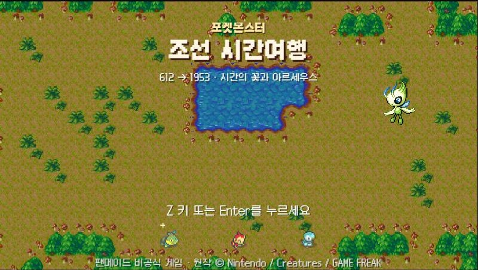
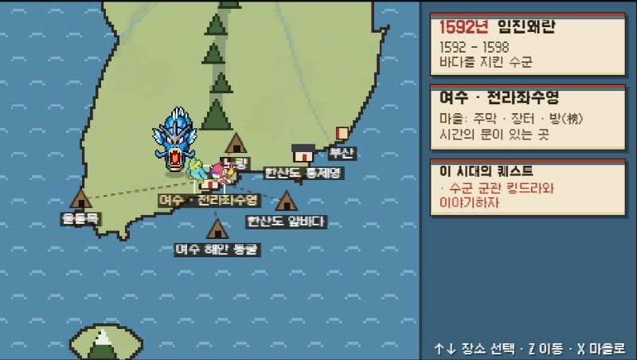
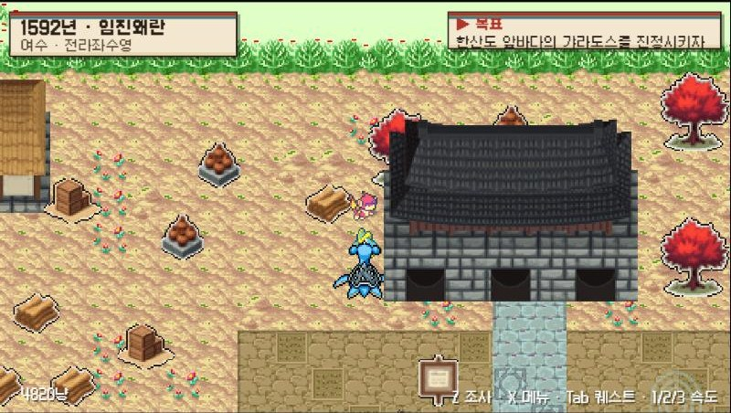
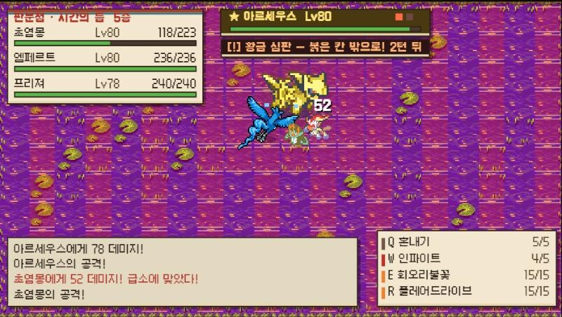

# 포켓몬 조선 시간여행

**고구려 살수대첩(612)부터 한국 전쟁 정전(1953)까지, 18개 시대를 여행하는 「포켓몬 불가사의 던전」풍 비공식 팬게임**

세레비와 함께 부서진 「시간의 꽃」 꽃잎 18장을 찾아 한반도의 역사 속을 여행합니다. 각 시대 사람들과 포켓몬의 소원을 들어주면 꽃잎이 다시 빛나고, 다음 시대로 가는 시간의 문이 열립니다. 이야기는 실제 역사의 흐름을 따라갑니다.

> 이 게임은 닌텐도·크리처스·게임프리크·스파이크 춘소프트와 관계없는 **비상업 팬게임**입니다. 아래 [저작권 고지](#저작권-고지)를 꼭 읽어 주세요.

## 바로 플레이

| 주소 | 비고 |
|---|---|
| **https://joseon-poke-timetravel.netlify.app** | Netlify |
| **https://jbh99.github.io/joseon-poke-timetravel/** | GitHub Pages (이 저장소에서 자동 배포) |

- 설치 없이 브라우저에서 바로 실행됩니다. PC의 크롬·엣지·파이어폭스를 권장하고, 스마트폰은 화면 버튼으로 조작합니다.
- 처음 접속하면 게임 가이드가 열립니다. 게임 중에도 **H** 키나 오른쪽 위 **가이드** 버튼으로 다시 볼 수 있습니다.

| 타이틀 | 세계 지도 |
|---|---|
|  |  |
| **마을** | **황금빛 아르세우스 (2페이즈)** |
|  |  |

## 조작법

| 키 | 기능 |
|---|---|
| **방향키** | 이동 (던전은 8방향, 대각선은 두 키를 동시에) |
| **Z / Enter / Space** | 조사 · 대화 · 기본 공격 · 결정 |
| **X / Esc / C** | 메뉴 · 취소 (예/아니오 질문에서는 '아니오') |
| **Q W E R** | 던전에서 기술 1~4 사용 |
| **Tab** | **태그**: 던전에서 조종할 포켓몬을 다음 동료로 교대 (턴 소모 없음) |
| **A** (누르고 있기) | 쉬기 · 턴 넘기기 |
| **Shift + 방향키** | 제자리에서 방향만 바꾸기 |
| **J** | 퀘스트 목록 열기 · 한 번 더 누르면 닫기 |
| **P** | 동료 명부 열기·닫기 (마을과 세계 지도에서, 던전 밖에서만) |
| **M** | 던전 미니맵 켜고 끄기 |
| **1 / 2 / 3** | 게임 속도 1배 · 2배 · 3배 |
| **H** | 게임 가이드 열기·닫기 |
| **마우스** | 세계 지도에서 가고 싶은 장소 클릭 · 대화와 선택지, 메뉴 클릭 |

- **X 메뉴 → 설정**에서 소리 켜기/끄기, 화면 아래 조작키 안내 보이기/숨기기, 게임 속도를 바꿀 수 있습니다. 오른쪽 위 **소리** 버튼으로도 바로 끌 수 있습니다.
- **X 메뉴 → 게임 종료**: 마을에서는 기록을 남기고 타이틀로 돌아갑니다. 던전 안에서 끝내면 던전 진행은 저장되지 않고, 마지막으로 마을에 들렀을 때부터 이어집니다.
- 오른쪽 위 **English / 한국어** 버튼을 누르면 게임을 다시 시작하지 않고 대사, 이름, 메뉴가 그 자리에서 바뀝니다.

## 게임 진행

1. **새로운 여행**에서 주인공과 파트너를 고릅니다 (모부기·불꽃숭이·팽도리). 시간을 건너온 탓에 둘 다 **이로치**입니다.
2. **마을**: 머리 위에 **!** 표시가 있는 포켓몬이 메인 퀘스트 상대입니다.
   - **주막**: 회복 · 기록 · 동료 명부
   - **장터**: 도구 사고팔기
   - **방(榜)**: 의뢰 게시판
   - 많은 시대에 큰 중심 마을과 함께 **두 번째 마을**이 있습니다.
3. **세계 지도**: 마을 출구로 나가면 열립니다. 클릭하거나 방향키로 장소를 고릅니다. 빨간 표시는 메인 퀘스트, 파란 표시는 맡은 의뢰, 금색 표시는 전설의 포켓몬이 있는 곳입니다.
4. **던전**: 층마다 지형이 무작위로 만들어지는 턴제 던전입니다. 계단을 찾아 내려가고, 마지막 층의 보스를 쓰러뜨립니다.
5. 메인 퀘스트를 끝내면 광장의 **시간의 문**이 열리고 다음 시대로 넘어갑니다.
6. 마을에 돌아올 때마다 **자동 저장**됩니다. 저장은 브라우저(localStorage)에 남으니 같은 브라우저에서 **이어하기**를 고르세요.

메인 스토리만 하면 1배속으로 약 4시간 안팎, 3배속으로 2~3시간쯤 걸립니다 (의뢰는 제외, 플레이 실력에 따라 차이가 큽니다).

## 18개 시대

| 연도 | 시대 | 마을 | 메인 던전 | 주요 보스 |
|---|---|---|---|---|
| 612 | 살수대첩 | 평양성 / 살수 나루 | 요동 들판, 살수(해전) | 성원숭, 메깅 |
| 660 | 황산벌 전투 | 사비성 / 웅진성 | 황산벌, 부소산성 | 켄타로스, 나인테일 |
| 676 | 나당 전쟁 | 서라벌 / 감포 바닷가 | 매소성, 기벌포(해전) | **썬더**, 킹크랩 · 루기아(선택) |
| 1019 | 귀주대첩 | 개경 / 서경 | 흥화진 냇물(해전), 귀주 벌판 | 대짱이, 날쌩마 |
| 1232 | 대몽 항쟁 | 강도(강화) / 충주성 | 처인성, 황룡사 | 프테라, **파이어** |
| 1388 | 위화도 회군 | 개경 · 고려 말 / 남원 운봉 | 진포(해전), 황산, 위화도 | 대포무노, 다탱구, **프리져** |
| 1392 | 조선 건국 | 한양 / 개경 · 옛 도읍 | 인왕산 숲길 | 링곰 |
| 1443 | 훈민정음 | 한양 · 집현전 | 집현전 서고 | 동탁군 |
| 1592 | 임진왜란 | 여수 · 전라좌수영 / 한산도 통제영 | 한산도 · 울돌목 · 노량 (모두 해전) | 갸라도스, 아그놈 |
| 1636 | 병자호란 | 남한산성 / 강화도 | 눈보라 산길 | 맘모꾸리 · 레지기가스(선택) |
| 1794 | 수원 화성 | 수원 화성 | 숙지산 채석장 | 유크시, 거대코뿌리 |
| 1866 | 병인양요 · 신미양요 | 강화도 | 정족산성, 광성보 | **가디안**, 자포코일 · 크레세리아(선택) |
| 1887 | 대한제국 | 한성 / 제물포 항구 | 건청궁 발전소 | 에레키블, **메타그로스** · 지라치(선택) |
| 1919 | 3·1 운동 | 경성 / 아우내 장터 | 경성 뒷골목 | 엠라이트, **디아루가** |
| 1920 | 독립군 | 독립군 기지(만주) / 용정 | 청산리 골짜기 | 핫삼 · 히드런(선택) |
| 1940 | 민족 말살 통치 | 경성(1940) / 충칭 · 임시정부 | 반전세계 | 다크라이, **기라티나** |
| 1945 | 광복 | 서울 | 시간의 틈 | **펄기아** |
| 1950 | 한국 전쟁 | 진영에 따라 다름 | 낙동강, 해전, 장진호, 판문점 | **한카리아스**, 보만다, **아르세우스** |

## 게임 요소

### 전설의 포켓몬과 보스
- **썬더(676) · 파이어(1232) · 프리져(1388)**: 같은 시대 보스 중 가장 강합니다. 체력이 보통 보스의 약 10배이고, 예고 공격을 모으는 동안에도 계속 공격합니다. 어렵다면 레벨을 올려 다시 도전하세요. 전설의 레벨은 일정 이상 오르지 않습니다.
- **예고 공격**: 보스가 바닥을 붉게 표시하면 몇 턴 뒤 그 칸에 큰 공격이 떨어집니다. 붉은 칸 밖으로 피하면 보스에게 **빈틈**이 생겨 받는 피해가 1.5배가 됩니다.
- **600족 보스**: 가디안(1866), 메타그로스(1887), 한카리아스·보만다·마기라스(1950)는 실제 능력치처럼 빠르고 단단합니다.

### 2페이즈
- **아르세우스**(최종 보스, Lv80): 쓰러뜨리면 **황금빛 이로치**로 다시 일어납니다. 체력은 처음의 2/3이고, 공격과 예고 패턴이 훨씬 거세집니다.
- **디아루가(1919) · 기라티나(1940) · 펄기아(1945)**: 쓰러뜨리면 **오리진폼**으로 변해 2페이즈를 시작합니다.
- **기라티나**는 고스트·드래곤 타입이라 격투 기술은 듣지 않고 물·불꽃 기술은 반감됩니다. 1388년에 동료가 되는 프리져처럼 얼음·드래곤·고스트·악 기술을 쓰는 동료를 데려가세요.

### 해전 (물 타입만 참가)
살수, 기벌포, 흥화진, 진포, 한산도, 울돌목(명량), 노량, 인천·대동강처럼 물 위에서 벌어지는 싸움에는 **물 타입 포켓몬만** 배에 오릅니다. 파티와 동료 명부의 물 타입이 자동으로 타고, 모자라면 수군이 빌려줍니다. 첫 시대에 리아코와 물짱이를 받습니다.

### 한국 전쟁 진영 선택
1950년에는 진영을 고릅니다. 진영마다 마을, 동료, 이야기, 해전 던전이 달라집니다.

| 진영 | 마을 | 함께하는 포켓몬 |
|---|---|---|
| 남쪽 · 대한민국 | 부산 임시 수도 / 대구 피란민 거리 | 윈디, 킹드라, 피죤투 |
| 북쪽 | 평양 / 흥남 부두 | 링곰, 무장조, 코리갑 |

### 동료
- 쓰러뜨린 야생 포켓몬은 **35%** 확률(이로치는 70%)로 동료가 되고 싶어 합니다. **보스와 전설의 포켓몬은 이기면 반드시** 동료로 맞이할 수 있습니다.
- 파티는 주인공·파트너·동료 1마리, 모두 3마리입니다. 나머지는 **동료 명부**(최대 99마리)에서 기다리며 경험치를 절반씩 받습니다.
- **동료 바꾸기**: 던전 밖(마을·세계 지도)에서 **P**를 누르거나, X 메뉴의 **동료 명부**, 주막 주인에게 말을 걸어 명부를 엽니다. 데려갈 포켓몬을 고르면 세 번째 자리의 동료와 교체됩니다. 주인공과 파트너는 이야기 속 고정 캐릭터라 바뀌지 않습니다.
- **태그(Tab)**: 던전에서 조종하는 포켓몬을 다음 동료로 바꿉니다. 턴을 쓰지 않습니다. 조종 중인 포켓몬이 리더이고, 리더가 쓰러지면 던전 탐험이 실패하니 위험할 때 교대하세요.

### 엽전과 상점
- 엽전은 쓰러뜨린 적(레벨이 높을수록 많이, 보스는 10배), 바닥에 떨어진 엽전, **던전 클리어 보상**(층수 × 시대), 방(榜) 의뢰 보상으로 모읍니다.
- 쓰러지면 마을로 돌아오고 엽전의 10%(초반)~30%(후반)를 잃습니다.
- 장터 도구: 오랭열매(HP 30 회복), 자뭉열매(최대 HP의 절반), 주먹밥(HP 80 + 상태 이상 회복), 약초(상태 이상), 인삼(PP 회복), 탈출 부적, 돌팔매.

### 난이도
초반 시대는 적이 적게 나오고 약하게 때리며 HP도 빨리 찹니다. 시대가 지날수록 적이 많아지고 세지며, 회복도 느려집니다. 보스는 시대가 갈수록 더 강해지고, 후반 전설은 회복 도구와 타입 상성을 챙겨야 이길 수 있습니다.

### 함께 하기 (멀티플레이)
- 혼자 하던 게임에 친구를 불러 이야기를 같이 보고 던전을 같이 깰 수 있습니다. 혼자 하다가 언제든 방을 열 수 있습니다.
- **방 만들기**: 오른쪽 위 **멀티 → 방 만들기**를 누르면 6자리 방 코드와 초대 링크가 나옵니다.
- **참가하기**: 친구는 다른 컴퓨터나 휴대폰에서 같은 게임 주소를 열고, 초대 링크를 누르거나 **멀티 → 방 코드 입력 → 참가하기**를 합니다.
- 방장의 화면과 소리가 친구에게 실시간으로 전송됩니다. 던전에서는 친구가 파트너(P2)와 세 번째 동료(P3)를 직접 조종합니다 (방향키 이동, Z 공격, QWER 기술, A 쉬기). 최대 2명까지 참가할 수 있습니다.
- 친구가 나가면 그 포켓몬은 다시 자동으로 움직입니다. 저장은 방장의 게임에만 남습니다.
- WebRTC(PeerJS 공개 서버)로 연결하므로 두 사람 모두 인터넷이 필요합니다. 회사·학교처럼 방화벽이 강한 네트워크에서는 연결이 안 될 수 있습니다.

## 직접 실행하기

빌드 과정이 없는 순수 HTML·JavaScript(ES 모듈) 게임입니다. 모듈을 쓰기 때문에 파일을 직접 열면(`file://`) 동작하지 않고, 로컬 웹 서버가 필요합니다.

```bash
git clone https://github.com/jbh99/joseon-poke-timetravel.git
cd joseon-poke-timetravel
python -m http.server 8000 --directory web
```

브라우저에서 http://localhost:8000 을 엽니다.

## 프로젝트 구조

```
web/                    게임 본체 (이 폴더가 그대로 배포됩니다)
  index.html            화면, 가이드(한/영), 멀티 패널, 터치 버튼
  js/main.js            부팅, 게임 루프, 배속·소리·언어 설정
  js/core.js            캔버스, 입력(키보드·마우스·터치), 대화창, 메뉴
  js/game.js            포켓몬·기술·도구 데이터, 저장/불러오기
  js/content*.js        18개 시대의 이야기, 마을, 던전, 보스, 의뢰
  js/dungeon.js         턴제 던전, 전투, 보스 패턴, 2페이즈, 태그
  js/town.js            마을과 NPC
  js/scenes.js          타이틀, 시대 카드, 세계 지도, 엔딩
  js/quests.js          퀘스트 진행, 동료 명부, 설정 메뉴
  js/i18n.js            한국어/영어 실시간 전환
  js/pmd.js             불가사의 던전 스프라이트와 지형 타일 그리기
  js/net.js, netui.js   멀티플레이 (PeerJS)
  js/audio.js           배경음악, 울음소리, 효과음
  assets/               스프라이트, 지형, 음악, 데이터
  dev/                  자동 플레이 봇과 콘텐츠 점검 스크립트 (배포에서 제외)
tools/                  롬에서 그래픽·음악·데이터를 추출한 스크립트 (롬 파일은 포함하지 않음)
docs/screenshots/       README 스크린샷
```

- `web/dev/check.js`: 모든 시대의 퀘스트·도구·기술 참조, 마을 NPC와 출구, 던전 각 층의 계단·보스 도달 가능 여부를 한 번에 점검합니다. 로컬 서버에서 브라우저 콘솔에 `const c = await import('/dev/check.js'); await c.checkAll()` 를 입력합니다.
- `tools/pmd/`: 「포켓몬 불가사의 던전 파랑구조대」 롬에서 스프라이트, 초상화, 던전 지형을 꺼내는 도구입니다. 직접 소유한 롬이 있어야 합니다.

## 배포

- **GitHub Pages**: `main` 브랜치에 push하면 `.github/workflows/pages.yml`이 `web/`(dev 제외)를 배포합니다.
- **Netlify**: `tools/build_dist.ps1`로 `dist/`를 만든 뒤 `netlify deploy --prod --dir dist`로 올립니다.

## 저작권 고지

- 이 저장소는 **비공식·비상업 팬 프로젝트**입니다. 게임을 판매하거나 광고 수익을 얻지 않습니다.
- 포켓몬스터와 등장 포켓몬, 이름, 그래픽, 음악의 권리는 © Nintendo / Creatures Inc. / GAME FREAK inc.에 있습니다.
- 「포켓몬 불가사의 던전」 시리즈의 그래픽은 © Nintendo / Creatures / GAME FREAK / Spike Chunsoft에 있습니다.
- 게임 속 스프라이트, 지형, 음악은 개인이 소유한 「포켓몬스터 펄」과 「포켓몬 불가사의 던전 파랑구조대」에서 추출했습니다. **롬 파일은 이 저장소에 포함되어 있지 않으며 배포하지 않습니다.**
- 글꼴: 갈무리(Galmuri) — SIL Open Font License.
- 권리자의 요청이 있으면 해당 자료를 즉시 내리겠습니다.

---

## English

**Pokémon Joseon Time Travel** is an unofficial, non-commercial Mystery Dungeon-style fan game. With Celebi, you travel through eighteen eras of Korean history, from Goguryeo's Battle of Salsu (612) to the Korean War armistice (1953), and win back the eighteen petals of the Flower of Time.

- **Play**: https://joseon-poke-timetravel.netlify.app or https://jbh99.github.io/joseon-poke-timetravel/ in a desktop browser (phones get on-screen buttons). The **English / 한국어** button switches the language live.
- **Controls**:
  - Arrows move; Z/Enter attacks or confirms; X/Esc opens the menu or answers "no"; Q W E R use moves.
  - Tab tags the next teammate in; A (hold) rests; J opens and closes the quest list.
  - P opens the companion roster outside dungeons; 1/2/3 set the game speed.
  - The mouse picks places on the world map, dialogue choices and menu rows.
- **Features**:
  - Legendary bosses: Zapdos, Moltres, Articuno, Dialga, Giratina and Palkia; Dialga, Giratina and Palkia rise again in Origin Forme.
  - Arceus is the final boss and turns golden for a second phase.
  - Water-only naval battles; pick a side in the Korean War.
  - 35% recruit rate (legendaries always join) and a 99-slot roster.
  - Co-op: friends join from another computer, watch the host's screen and steer P2/P3 in dungeons.
- **Run locally**: `python -m http.server 8000 --directory web`, then open http://localhost:8000.
- **Notice**:
  - Pokémon © Nintendo / Creatures Inc. / GAME FREAK inc.; Pokémon Mystery Dungeon © Spike Chunsoft.
  - Graphics and music were extracted from personally owned cartridges. No ROMs are included.
  - Content will be taken down on request from the rights holders.
